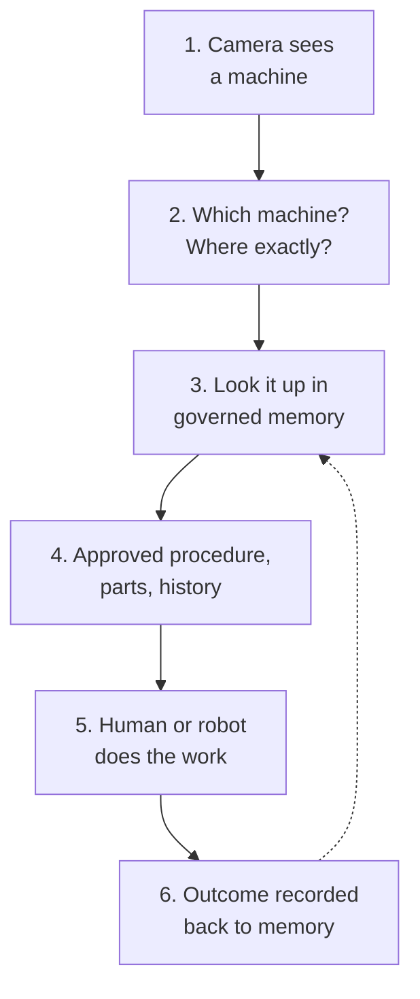
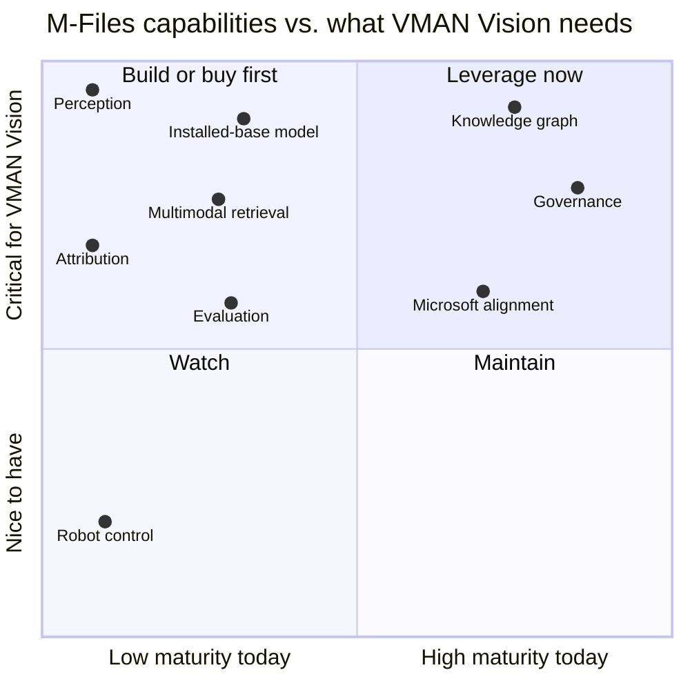
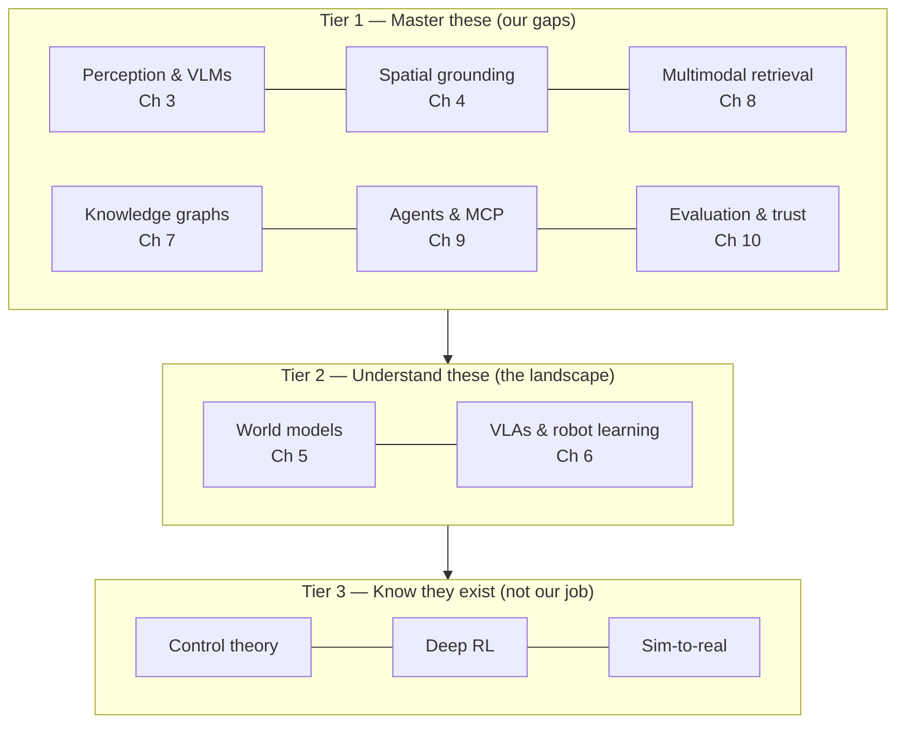

# Chapter 1 — The map: where M-Files stands

## Before the journey, the map

Imagine you're planning a hike up a mountain you've never climbed. Before you buy boots, you want two things: a map of the mountain, and an honest look at your own fitness. Are your legs strong? Is your lung capacity weak? The answers decide your training plan.

This chapter is that honest look — for M-Files, against the goal of VMAN Vision. Every later chapter teaches one of the areas this chapter identifies as a gap. That's why the book is shaped the way it is.

---

## The goal, in one picture

The goal is simple to say and hard to build:

> A technician points a phone (or a robot points a camera) at a machine. The system recognises **which** machine it is, **where** on it the problem is, and returns the **approved, governed** procedure for fixing it — with permissions checked and the outcome recorded.

Every box in that picture is a technology area. Some M-Files already does well. Some it doesn't do at all yet.

---

## How this map was built

The map comes from four kinds of evidence, not opinion:

1. **Our own strategy and roadmap pages** on Confluence — the Product Strategy 2025–26, the Manufacturing Blueprint, the 2027 forward-looking thoughts, and the CAD Integration Roadmap 2026–2029 [9]–[12].
2. **Our own repositories** — this one (`physical-agents-research`) and its sibling `complex-document-grounding-poc`, including what's been demonstrated versus merely proposed.
3. **Our own platform documentation** — the MCP Server beta page, the Aino architecture pages, and the AI-Metadata team's design documents as reviewed in `docs/differentiation-plan-vs-metadata-poc.md`.
4. **Dated external sources** — vendor documentation and industry reporting, listed in [Appendix B](appendix-b-sources.md).

---

## Our strengths

### Strength 1 — We already own a knowledge graph

M-Files doesn't store files in folders. It stores objects with metadata, and relationships between them — documents linked to projects, people, machines, and companies. The Product Strategy 2025–26 names this "knowledge-graph-like architecture" as how we win, and notes that "knowledge graphs are a favored format for AI" [9].

Why it matters: a physical agent needs memory. Not "search results" — *structured* memory: this pump belongs to that line, has this service history, and this is its approved maintenance procedure. That's a graph. We already have the shape. (Chapter 7.)

### Strength 2 — Governance is in our DNA

Permissions, versioning, audit trails, approval workflows. The Manufacturing Blueprint puts it crisply: "your systems keep the transaction, M-Files keeps the governed context" [10].

Why it matters: before any enterprise lets an AI act in the physical world, someone will ask *"who approved that procedure, and who is allowed to see it?"* We are one of the few vendors for whom that's the core product, not an afterthought. (Chapter 10.)

### Strength 3 — We don't compete with the systems robots plug into

The Blueprint states that M-Files does not compete with PLM, ERP, MES or EAM systems [10]. That makes us a natural *partner* for them rather than a threat.

Why it matters: the physical-AI race is being run by giants (Chapter 11). A partner-shaped product can plug into their stacks instead of fighting them.

### Strength 4 — Microsoft alignment

Our strategy pairs the knowledge graph with AI and Microsoft [9]. Our AI stack (Aino) already runs on Azure services.

Why it matters: most of our customers already trust Microsoft with their data. An Azure-native path for vision is much easier to approve than an external dependency. (Chapters 8 and 10.)

### Strength 5 — A working, honest prototype

This repository has a real, running vision-grounding demo, with side-by-side evidence from two providers on public engineering drawings, and documents that carefully separate what's proven from what isn't. (Chapter 4.)

### Strength 6 — A route to prove things fast

The 2027 forward-looking thoughts describe Forward Deployed Engineering: proving ideas "against a real customer's budget and urgency … ahead of when the core roadmap would otherwise reach it" [11].

Why it matters: we don't have to wait for the core roadmap to test this. There is a sanctioned path. (Chapter 13.)

---

## Our weaknesses (the gaps)

### Gap 1 — We can't see yet (perception)

No production M-Files AI surface reads images today. The MCP Server beta explicitly lists "image reading is not available in Beta" as a tracked limitation. The CAD Integration Roadmap says non-CAD users see drawings as "opaque blobs" [12].

**Taught in:** Chapter 3 (how machines see), Chapter 4 (spatial grounding).

### Gap 2 — Our search reads words, not pictures (retrieval)

Aino Search is built on text embeddings. The existing "Images" processing mode sends page images to the LLM only when files are small (≤10 MB) and silently falls back to text-only above that, per the AI-Metadata team's workflow documentation.

**Taught in:** Chapter 8 (retrieval that can see).

### Gap 3 — We can't point back to *where* an answer came from (attribution)

The metadata-poc design documents reviewed on 2026-09-08 contain no concept of citing back to a region on a page. Only the sibling repository's Document Intelligence adapter currently preserves region-level evidence.

**Taught in:** Chapter 4 and Chapter 8.

### Gap 4 — The asset memory is designed, not built

The Manufacturing Blueprint lists **Installed Base & Maintenance Knowledge** as *planned*: "equipment by serial number … approved maintenance procedures as governed steps an assistant renders verbatim" [10]. The 2027 thoughts confirm it's "validated design work, not yet built" [11]. The CAD roadmap's engineering-knowledge-graph milestone is dated H1 2028 [12].

**Taught in:** Chapter 7 (knowledge graphs) and Chapter 11 (architecture).

### Gap 5 — We can't yet prove how well it works (evaluation)

Every comparison in this repository is qualitative. There is no labelled evaluation set, no scoring rubric, no measured accuracy. The repository's own documents say so.

**Taught in:** Chapter 10 (trust).

### Gap 6 — Model access is awkward

The best spatial-grounding model we've tested (Gemini Robotics-ER 2) is a preview endpoint and isn't deployable inside Microsoft Foundry. The Foundry deployment we tested as a stand-in (`4Omni`, still routed under the legacy name `magma` in the demo) returned malformed output in two of six internal-drawing runs. Microsoft's own spatial model, Magma, is now listed in the Foundry model catalog. But it runs on dedicated-GPU "Managed Compute", which is still in preview, needs a quota request and depends on project/region availability. It's untested here, and its model card rules out production use (see `docs/magma-readiness.md`).

**Taught in:** Chapter 4 and Chapter 10.

### Gap 7 — The clock

SAP, Palantir, Siemens and PTC are already shipping or piloting the "ground the robot in enterprise data" story (Chapter 11). Our engineering-knowledge-graph milestone is 2028.

**Taught in:** Chapter 11.

---

## The map on one page

Read it like this: the **top-right** is what we should lean on in every conversation. The **top-left** is what this book mostly teaches — critical, and not yet mature. Robot control sits bottom-left on purpose: it's a real field, but it's not our job.

---

## The capability matrix

| Area | Today | Evidence | What it means for the goal | Chapter |
|---|---|---|---|---|
| Knowledge graph | **Strong** | Product Strategy 2025–26 [9] | The memory layer physical agents need | 7 |
| Governance | **Strong** | Manufacturing Blueprint [10] | The reason an enterprise would trust us | 10 |
| Partner positioning | **Strong** | Blueprint non-compete stance [10] | We plug into giants, not fight them | 11 |
| Microsoft alignment | **Strong** | Strategy [9], Aino on Azure | Easier approval path for vision | 8, 10 |
| Prototype evidence | **Partial** | This repo (qualitative only) | Proof the idea runs, not that it's accurate | 4 |
| Perception | **Missing** | MCP beta limitation; "opaque blobs" [12] | The first gap to close | 3, 4 |
| Multimodal retrieval | **Missing** | Aino text embeddings; 10 MB images cap | Search must see, not just read | 8 |
| Region attribution | **Missing** | metadata-poc review | "Show me where" builds trust | 4, 8 |
| Installed-base model | **Planned** | Blueprint [10], 2027 thoughts [11] | The graph nodes a photo must resolve to | 7, 11 |
| Evaluation | **Missing** | Repo docs: no labelled set | Without it, nothing is provable | 10 |
| Model access | **Awkward** | ER 2 preview, not in Foundry | Choose the path deliberately | 4, 10 |
| Robot control/training | **Out of scope** | By design | Understand it, don't build it | 5, 6 |

---

## What this means for the rest of the book

This book grew out of an earlier six-page personal guide, which was a general robotics curriculum: control theory, reinforcement learning, simulators. All useful — but the map above says M-Files' real gaps are elsewhere: **seeing, pointing, retrieving, remembering, and proving**. So this book flips the weight:

---

> ### Where M-Files stands
> **Strong on memory and trust. Missing the eyes.** We own the governed knowledge graph a physical agent would need to consult, and the governance an enterprise would demand. What we lack is the perception layer to connect a camera to that graph, the retrieval that can search pictures, and the evaluation discipline to prove any of it works. The rest of this book teaches exactly those pieces.
