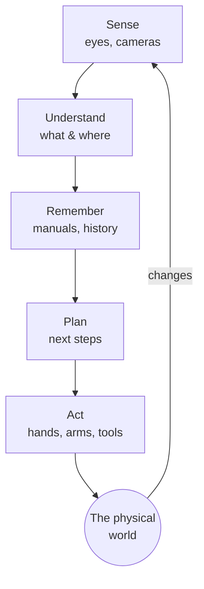
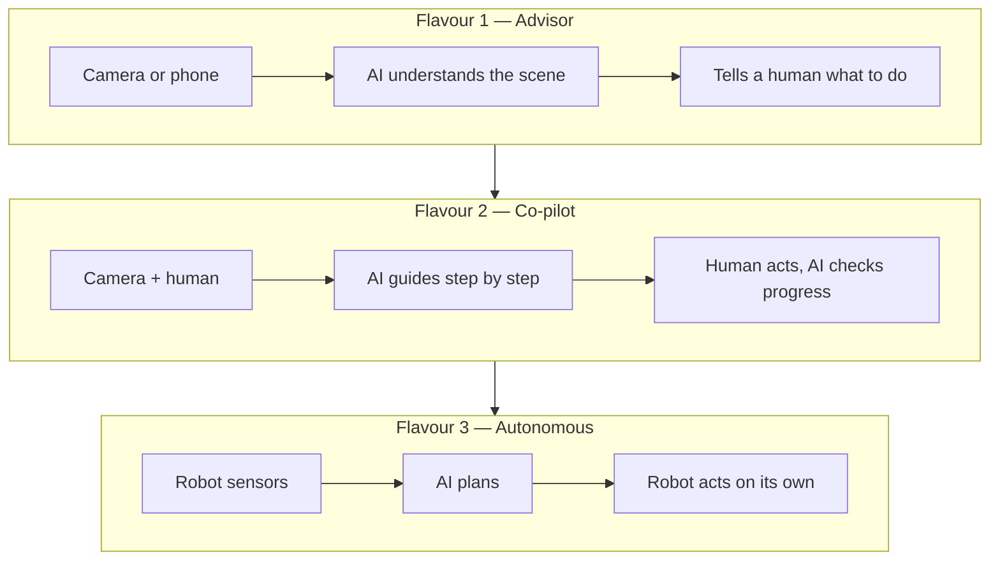
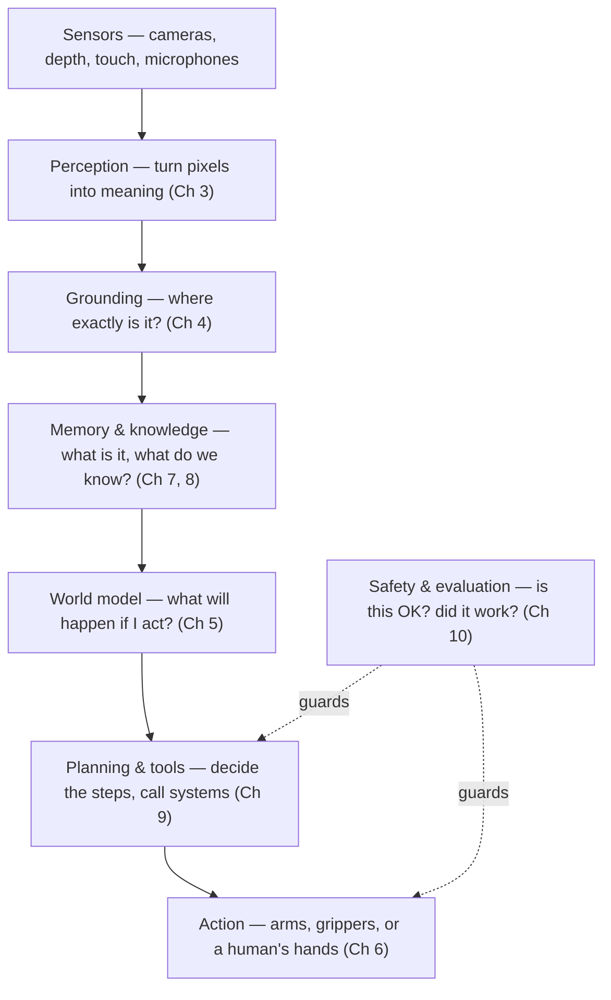

# Chapter 2 — What is a physical agent?

## Your first day on the factory floor

It's your first day as a maintenance technician. Your supervisor walks you to a humming machine and says:

*"The left pump is leaking. Fix it."*

Think about what you do next, step by step:

1. **You look.** Your eyes take in the machine — pipes, valves, a puddle.
2. **You find.** "Left pump" — which one is that? You locate it, and the exact joint that's dripping.
3. **You remember.** You recall (or look up) what this pump model is, what the manual says, and what parts fit it.
4. **You plan.** Shut the valve, drain the line, replace the seal.
5. **You act.** Your hands do the work.
6. **You check.** You look again. Still dripping? Back to step 1.

You just ran a loop: **sense → understand → remember → plan → act → check.** Every physical agent — human, robot, or software helping a human — runs some version of it.

The loop never really ends, because the world keeps changing — including because of what you just did.

---

## The formal definition

To formalise: **a physical agent is a system whose decisions must work through sensors, bodies or tools, in a real environment that changes — including in response to the agent's own actions.**

Three words in that definition carry the weight:

- **Sensors** — it can't just read text; it has to perceive the world (cameras, depth sensors, touch, sound).
- **Acts** — its output changes something physical, directly (a robot arm) or indirectly (a technician following its instructions).
- **Changes** — the world pushes back. Plans go stale. The agent has to check and adapt.

---

## Chatbot vs. physical agent

This is the most useful comparison in the whole book, so let's be precise.

| | Chatbot (LLM assistant) | Physical agent |
|---|---|---|
| **Input** | Text (maybe an image you upload) | Continuous sensor streams |
| **Output** | Text | Actions, or instructions a human executes |
| **World** | Frozen — the conversation is the world | Live — it changes while you think |
| **Mistakes cost** | A wrong sentence | A broken part, a safety incident |
| **"Done" means** | The answer was written | The world is in the right state |
| **Needs to know *where*?** | Rarely | Always |

That last row is the one to remember. A chatbot can say *"the valve near the tank."* A physical agent has to know *which pixel, which bolt, which millimetre.* This is why Chapter 4 — pointing — matters so much.

---

## The three flavours of physical agent

Not every physical agent has a robot body. It helps to think of three flavours:

1. **Advisor** — a technician photographs a machine; the system identifies it and returns the right procedure. The human does everything physical.
2. **Co-pilot** — the system watches (e.g. through a tablet or headset) and guides, step by step, checking progress.
3. **Autonomous** — a robot perceives, plans, and acts itself.

Most of the industry noise is about flavour 3 — humanoids, robot arms. But flavours 1 and 2 are where most near-term enterprise value sits, and they need the same underlying capabilities: seeing, locating, remembering, and checking.

> **Important for M-Files:** the Manufacturing Blueprint says M-Files "records outcomes and recommends actions; it does not execute transactions" [10]. That maps cleanly onto the three flavours: M-Files is the memory and the advice in all three — it is never the hands.

---

## What's inside a physical agent

Let's open the box. A modern physical agent is built from a stack of parts, and the rest of this book takes them one at a time:

Notice that safety isn't a layer at the end — it watches the planning and the action.

---

## Three misunderstandings to avoid

The field moves fast, and people blur terms. Three common confusions:

1. **"An LLM is a world model."** Not automatically. An LLM predicts the next *word*. A world model predicts the next *state of the world* after an action. Language knowledge helps, but it isn't physics. (Chapter 5.)
2. **"If it can describe the image, it can act on it."** No. *"There's a valve on the right"* is a description. *"The valve is at pixel (870, 540), and turning it clockwise closes the outlet"* is actionable. Description is not grounding. (Chapter 4.)
3. **"A great benchmark score means it's safe."** Benchmarks measure a specific robot, dataset, and task. They don't prove safety under new lighting, new machines, or new failure modes. (Chapter 10.)

---

## Why now?

Three things changed at roughly the same time:

- **Models learned to see well.** Vision-language models can now describe *and* locate things in images reliably enough to be useful.
- **Robot data exploded.** Large shared datasets and cheap video made it possible to train general-purpose robot policies, not one model per task.
- **Money arrived.** McKinsey sizes the 2040 general-purpose robotics market at about **$370B**, up from under $1B in 2025, with logistics and discrete manufacturing making up roughly 60% of it [5].

NVIDIA's Jim Fan puts the moment in one phrase: robotics is repeating the language-model playbook — scale data and compute, and capability emerges — and we're early in that curve [1].

---

> ### Where M-Files stands
> M-Files doesn't need to build robots to be part of this. In every flavour of physical agent — advisor, co-pilot, autonomous — the agent has to *remember*: what this machine is, what's been done to it, what the approved procedure is. That memory is M-Files' home turf. What we're missing is the *sensing* half: the ability to go from a camera image to the right object in our graph. That's the next two chapters.
