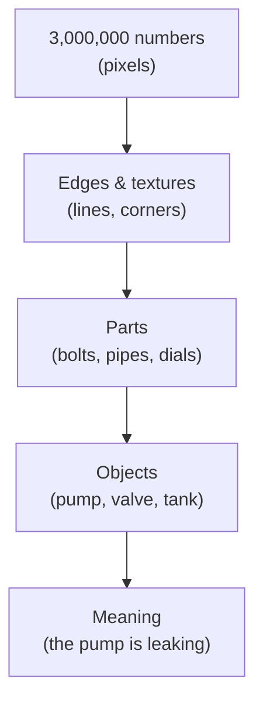
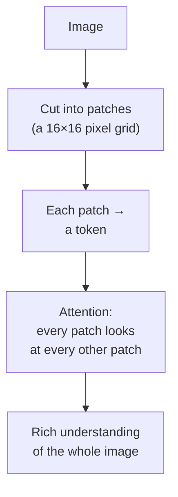
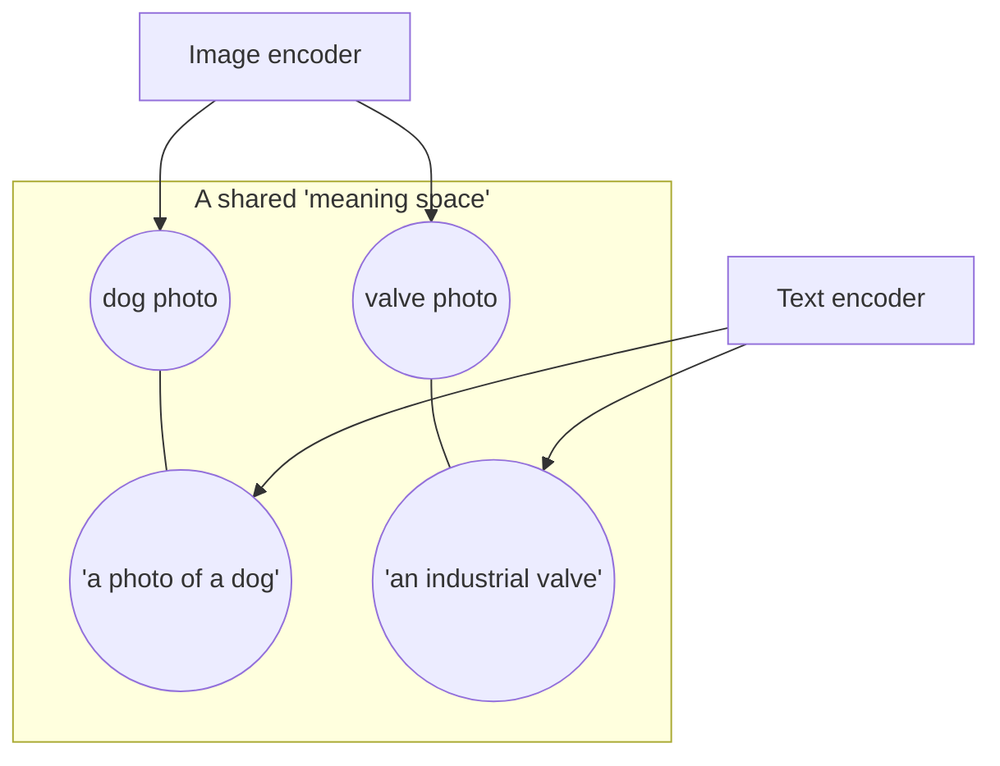
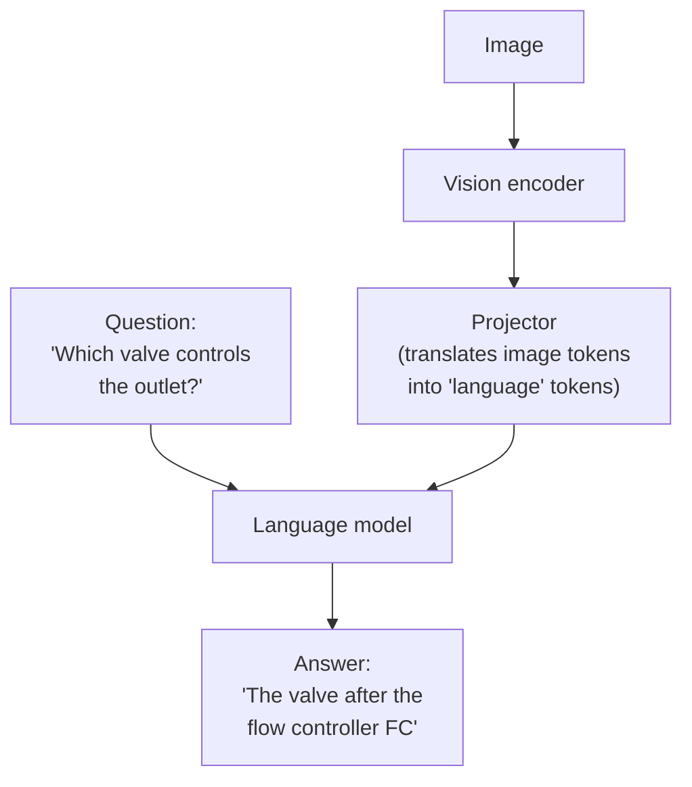
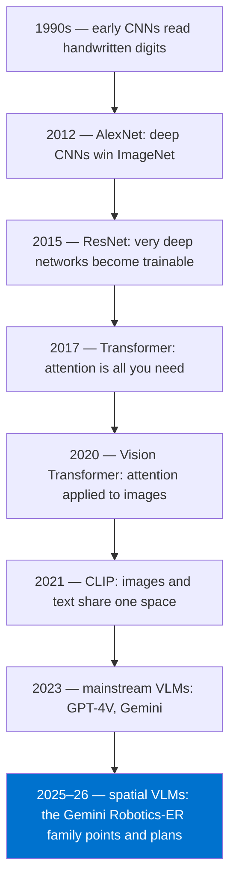

# Chapter 3 — How machines see

## A photo is just a spreadsheet of numbers

Open any photo on your laptop and zoom in until you see individual squares. Each square — a pixel — is three numbers: how much red, how much green, how much blue. A 1000×1000 photo is three million numbers.

That's all a computer "sees". There's no pump in there, no valve, no leak. Just a very large spreadsheet of brightness values.

So the whole problem of computer vision is this: **how do you get from three million numbers to "the left pump is leaking"?**

Each step compresses the numbers into something more meaningful. Modern vision models learn these steps from data rather than having them hand-coded.

---

## Step 1 — Finding edges and patterns (CNNs)

Imagine sliding a small magnifying glass over the photo, one patch at a time, asking a single question: *"is there a vertical edge here?"* Then another glass asks *"is there a curve?"* Another: *"a circle?"*

That's a **convolutional neural network (CNN)**. Small filters slide across the image; early layers learn edges, middle layers learn shapes, late layers learn whole objects. CNNs (made famous by AlexNet in 2012 and ResNet in 2015) are what made computer vision practical at scale.

To formalise: **a CNN is a neural network that applies small learned filters across an image to build up a hierarchy of features, from edges to objects.**

---

## Step 2 — Looking at everything at once (Vision Transformers)

CNNs look locally — patch by patch. But understanding a drawing often needs *long-range* connections: the label in the corner explains the symbol in the middle.

The **Vision Transformer (ViT)** takes a different approach. It cuts the image into a grid of patches (say 16×16 pixels each), turns each patch into a list of numbers called a *token*, and lets every patch "pay attention" to every other patch.

This is the same attention mechanism that powers language models — which turned out to matter enormously, because it let vision and language be combined in one model.

---

## Step 3 — Connecting pictures to words (CLIP)

Here's a clever trick. Take 400 million images from the internet, each with its caption. Train two encoders — one for images, one for text — so that a photo of a dog and the sentence *"a photo of a dog"* end up as *nearby* points in the same mathematical space.

That's **CLIP** (OpenAI, 2021). After training, you can compare any image to any sentence, even ones it never saw.

This idea — **putting images and text in the same space** — is the foundation of modern multimodal AI, and of multimodal search (Chapter 8).

---

## Step 4 — Models that see *and* talk (VLMs)

Now combine it all. Take a vision encoder (a ViT), feed its tokens into a large language model, and train the pair together. You get a **vision-language model (VLM)**: you can show it an image and ask questions in plain language.

To formalise: **a VLM is a model that jointly processes images and text, so it can answer questions about images, describe them, and — in the better ones — locate things in them.**

GPT-4o, Gemini, and Claude are all VLMs. Gemini Robotics-ER 2 is a VLM specialised for spatial and physical reasoning (Chapter 4).

---

## OCR vs. vision understanding

This distinction is at the heart of M-Files' current gap, so it deserves its own section.

**OCR (optical character recognition)** answers one question: *what are the characters on this page?* It's decades old, extremely reliable for printed text, and still the right tool for reading text.

**Vision understanding** answers different questions: *what does this diagram mean? Which symbol is the pump? How is this valve connected to that tank?*

| | OCR | Layout analysis | Vision understanding (VLM) |
|---|---|---|---|
| **Question it answers** | What text is here? | Where are the text blocks, tables, figures? | What does this mean, and where is it? |
| **Output** | Characters and words | Regions, tables, reading order | Descriptions, answers, points, boxes |
| **Engineering drawing** | Reads the labels | Finds the title block | Understands the symbols and connections |
| **Chart** | Reads axis numbers | Finds "a figure" | Reads the trend |
| **Reliability** | Very high | High | Good but can hallucinate |
| **Example** | Classic OCR engines | Azure Document Intelligence | Gemini, GPT-4o |

Try running classic OCR on a P&ID (piping and instrumentation diagram). You'll get a scatter of tags — "FC", "PI", "LP Steam" — with no idea how they connect. That's why our CAD Integration Roadmap describes drawings as "opaque blobs" to non-CAD users [12]. The text is there. The *meaning* isn't.

---

## Where vision models still struggle

VLMs are impressive, but a good engineer knows the failure modes:

- **Tiny details.** Models usually downscale images. A 6-point font dimension on an A0 drawing can vanish. (Fix: crop and re-inspect — Chapter 4.)
- **Counting.** "How many bolts?" is surprisingly hard. Models guess.
- **Hallucination.** A model may confidently describe a valve that isn't there. Google's own documentation warns that spatial outputs can be wrong, especially on unusual inputs [17].
- **Domain symbols.** Standard P&ID symbols are learnable; a company's in-house symbol conventions may not be.
- **Consistency.** The same image and prompt can give slightly different answers on different runs.

None of these are reasons not to use VLMs. They are reasons to *always check the output visually* and to build an evaluation set before making claims (Chapter 10).

---

## The timeline in one picture

---

> ### Where M-Files stands
> **Missing, but buyable.** M-Files doesn't need to train a vision model — world-class ones are available as APIs from Google and Microsoft. What's missing is the *wiring*: no production M-Files surface sends images to a vision model and does something useful with the answer. The MCP Server beta explicitly can't read images. The good news: this is the most solvable gap on the map, because the hard part (the model) already exists. The next chapter covers the specific vision capability that matters most for us.
