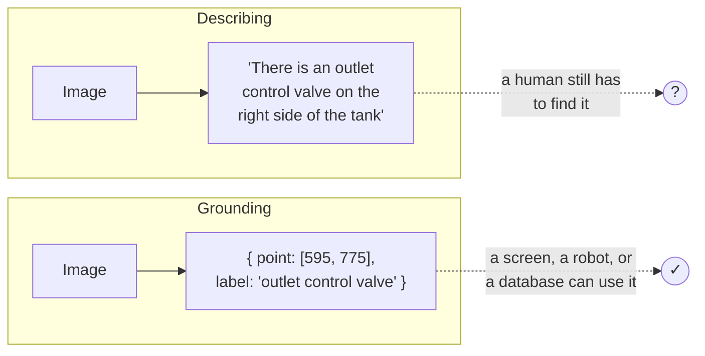
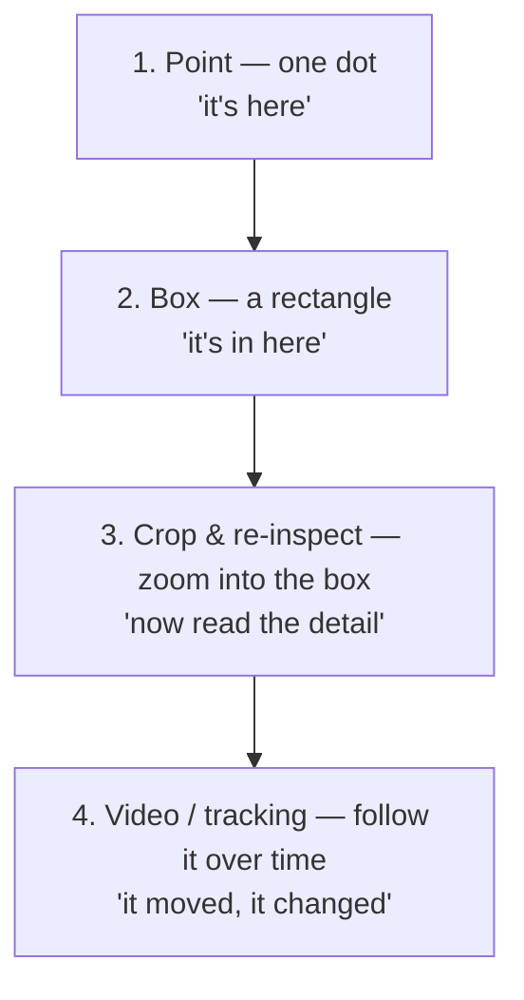
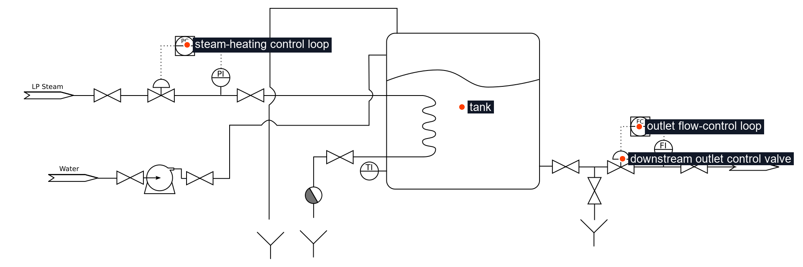
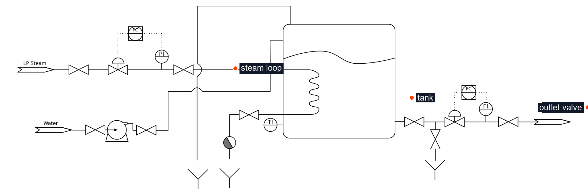
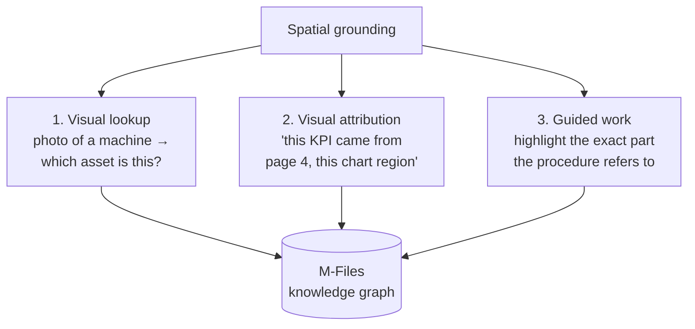
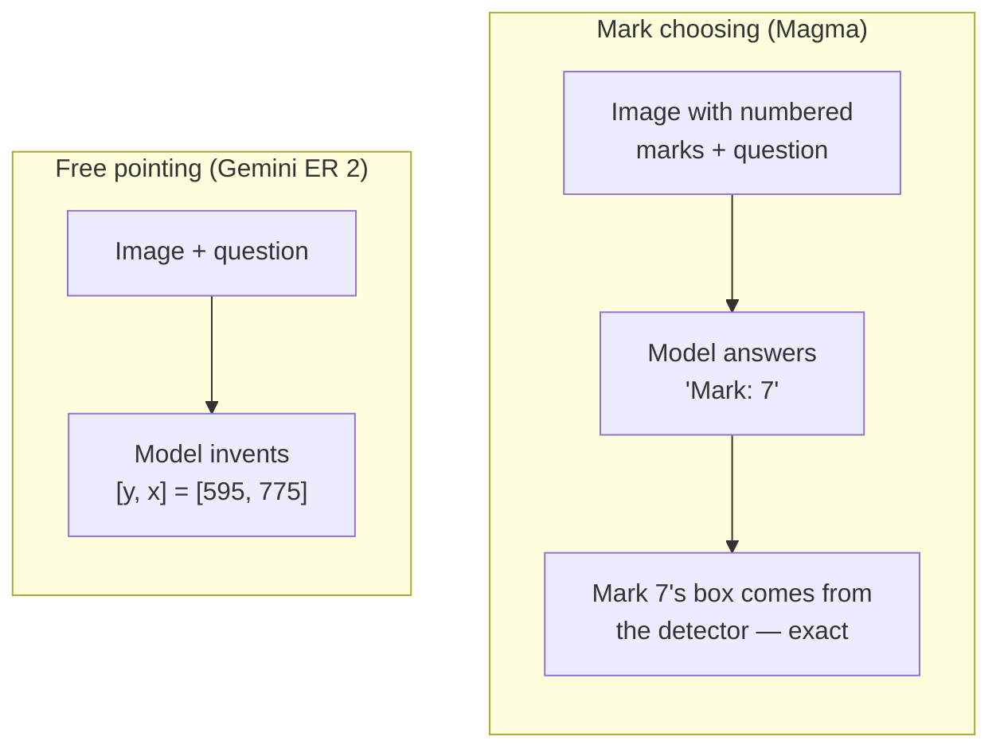

# Chapter 4 — Pointing, not describing

## "The valve on the right"

You're on a phone call with a colleague who's standing in front of a machine. You're looking at the drawing. You say:

*"Close the valve on the right."*

Silence. Then: *"There are four valves on the right."*

You try again: *"The one just after the flow controller, before the outlet."* Better. But what you really want to do is reach through the phone and **put your finger on it.**

That's the difference this chapter is about. Describing a thing is not the same as locating it. Language is great at the first. Physical work needs the second.

---

## What spatial grounding is

To formalise: **spatial grounding is the ability of a model to connect words to locations — to answer not just "what is in this image?" but "where exactly is it?"**, as coordinates you can draw, measure, or send to a machine.



A description needs a human to interpret it. A coordinate can be drawn on a screen, matched to a region of a drawing, or passed to a robot arm.

---

## How coordinates are expressed: the 0–1000 grid

Images come in every size. A phone photo might be 4000×3000 pixels; a scanned A0 drawing might be 14000×10000. If a model answered in raw pixels, the answer would depend on the size of the file you sent.

So spatial models use a **normalised grid**. Gemini Robotics-ER 2 returns points as **[y, x]**, each on a scale from **0 to 1000**, regardless of image size:

```
(0, 0) ─────────────────────────── x → (0, 1000)
  │
  │           • [400, 575]  "tank"
  │
  y                 • [595, 775] "outlet valve"
  ↓
(1000, 0)                          (1000, 1000)
```

Two details trip everyone up the first time:

- **y comes first.** It's `[y, x]`, not `[x, y]`. Mix them up and every point lands in the wrong place.
- **It's a fraction, not a pixel.** 500 means "halfway", whether the image is 800 or 8000 pixels wide.

Converting back to pixels is one line of arithmetic. This is exactly what `prototype/overlay.py` does:

```python
x_pixel = int(x_normalised / 1000 * image_width)
y_pixel = int(y_normalised / 1000 * image_height)
```

---

## Four ways to locate something

Pointing is only the first rung. Spatial models can locate things with increasing precision:



| Method | Output | Good for | Documented for Gemini ER 2 [17] | Tested in this repo |
|---|---|---|---|---|
| **Point** | `[y, x]` + label | "Which one?" — identifying things | Yes | **Yes** — demonstrated |
| **Box** | `[ymin, xmin, ymax, xmax]` + label | Regions: a chart, a title block, a part | Yes | Not yet |
| **Crop & re-inspect** | A second, focused answer about a region | Tiny text, dials, dimensions | Yes (agentic code execution) | Not yet |
| **Video / tracking** | Points or events across frames | Progress, "when did it change?" | Yes | Not yet (and needs a privacy plan) |

Each rung builds on the last. That's why the repository's own proposal scopes the next experiments as *box vs. point* and *crop and re-inspect*, and explicitly leaves video and robot orchestration out of scope for now.

---

## What we actually demonstrated

Here is a real output from this repository. Both models received the same public P&ID (a steam-heated tank with a flow-control loop) and the same prompt: point to the tank, the steam-heating control loop, and the outlet flow-control loop, and label the downstream outlet control valve.

**Gemini Robotics-ER 2:**



**Azure AI Foundry `4Omni`** (routed as `magma` in the demo; it is not Microsoft Magma):



*Side-by-side version: `demo-results/public-pid-tank/comparison/gemini-er2-vs-foundry-4omni.jpg`.*

Look closely at two labels, and at the raw numbers each model returned (saved in `demo-results/public-pid-tank/*/result.json`):

| Label | Gemini ER 2 returned | Foundry 4Omni returned | What you see |
|---|---|---|---|
| outlet valve | `[595, 775]` | `[550, 1050]` | Gemini's dot sits on the valve after the flow controller. Foundry's x value is **1050 — outside the 0–1000 grid.** The overlay code clamps it to the image edge, which is why that dot hugs the right border. |
| outlet loop | `[474, 796]` | `[550, 1100]` | Same story: x = 1100 is off the grid. |
| tank | `[400, 575]` | `[500, 700]` | Gemini's dot is inside the tank; Foundry's sits just outside its right wall. |

Both models *described* the scene sensibly — the labels are all reasonable. Only one *located* it correctly **in this example**, and the other broke the coordinate contract outright. That is precisely the gap between describing and grounding — and a reminder to **validate that every coordinate is inside 0–1000** before trusting it.

Now the honest part. This is one image. Across the repository's runs:

| Run | Gemini ER 2 | Foundry 4Omni |
|---|---|---|
| Six internal engineering drawings | Parseable points on 6 of 6 | Parseable on 4 of 6, malformed on 2 |
| Three simple public fixtures | Parseable points on all | Parseable points on all |
| Three complex public fixtures | Parseable on all (14–20 points) | Parseable on all (19–20 points) |

"Parseable" means the model returned valid coordinates we could draw. It does **not** mean the points were correct. Nobody has yet labelled the drawings with the true locations and measured the error. Until that's done (Chapter 10), these are demonstrations, not benchmarks.

---

## Why grounding matters for M-Files specifically

Grounding unlocks three things a text pipeline can't do:



1. **Visual lookup** — resolve a photo to the right object in the vault, even when the asset tag is worn or unreadable.
2. **Visual attribution** — every answer can point back to *where* on the page it came from. The repository's review of the metadata-poc design found no region-level attribution concept at all (Chapter 8).
3. **Guided work** — a procedure step says "replace the seal on flange B"; grounding highlights flange B on the photo.

---

## Grounding vs. OCR bounding boxes

A fair question from a reviewer: *"Azure Document Intelligence already returns bounding boxes. Isn't that grounding?"*

It's a different kind of box.

| | OCR / layout boxes (e.g. Document Intelligence) | Semantic grounding (e.g. Gemini ER 2) |
|---|---|---|
| **Boxes around** | Text lines, words, table cells, figures | Whatever you asked about in plain language |
| **Driven by** | The page's structure | Your question |
| **Can find a symbol with no text?** | No | Yes |
| **Deterministic?** | Highly | No — it's a model's judgement |
| **Best used for** | Trustworthy text citation | Visual meaning and symbols |

The two are complementary. The repository's own recommendation is to start Azure-native (Document Intelligence or Content Understanding as the extraction and citation foundation) and use semantic grounding for the visual cases those tools can't solve [18].

---

## Another way to point: choosing a numbered mark

Back to the phone call. Instead of asking your colleague to find "the valve after the flow controller", imagine you'd both stuck numbered sticky notes on every valve beforehand. Now you just say: *"Close number 7."* No ambiguity at all.

That's **Set-of-Mark (SoM)** grounding, the technique behind Microsoft's Magma model [21]. Something else — a detector, a layout tool, even a simple grid — draws numbered marks on candidate regions first. The model's job shrinks from "find the exact pixel" to "pick the right number".



| | Free pointing | Choosing a mark |
|---|---|---|
| **Who decides the location?** | The model | The detector draws the candidates; the model chooses |
| **Needs something upstream?** | No | Yes — something must propose the marks |
| **Coordinates as precise as…** | The model's guess | The detector's box |
| **Fails when…** | The point drifts, or goes off the grid | The right thing never got a mark |

Magma's paper shows the idea works: taking marks out of its training cut its ScreenSpot score from 61.4 to 57.4 and halved its robot-simulation score (35.4 to 17.7) [21]. For engineering drawings nobody has tested it yet, and the hard part is the upstream step — drawings have no built-in list of candidate regions the way a web page does. `docs/magma-readiness.md` sets out the options.

Two format traps if you ever parse both models' output: Magma writes `(x, y)` from 0 to 1; Gemini writes `[y, x]` from 0 to 1000. Same idea, opposite order, different scale.

---

## The model landscape (as of September 2026)

| Model | What it is | How to call it | Notes |
|---|---|---|---|
| **Gemini Robotics-ER 2** (`gemini-robotics-er-2-preview`) | Google's embodied-reasoning VLM, built on Gemini 3.5 Flash | Gemini API | Preview; points, boxes, trajectories, video, agentic vision [17] |
| **Gemini Robotics-ER 2 streaming** | Low-latency variant | Gemini Live API | For continuous audio/video; out of scope for documents |
| **Gemini Robotics 2** | Google's vision-language-*action* model for robots | No public API model ID found | Robot control, not our use case (Chapter 6) |
| **Azure Foundry general vision models** | GPT-4o-class multimodal models | Azure AI Foundry | Inside Microsoft's boundary; weaker at precise pointing in our runs |
| **Microsoft Magma-8B** | Microsoft Research's vision-language-action model; answers by choosing numbered marks on the image | Listed in the Foundry catalog; Foundry Managed Compute (preview) if available in your project (needs GPU quota), or self-host (~17 GB GPU memory in bf16) | MIT licence; research use only per its model card; untested here — see `docs/magma-readiness.md` |

Two practical warnings from Google's own documentation [17]:

- **Spatial outputs can be wrong or hallucinated**, especially on ambiguous or unusual inputs. Always draw the points and look.
- Google recommends **low "thinking" levels for simple pointing** and higher levels for counting or estimation — higher levels cost more and take longer.

---

> ### Where M-Files stands
> **Demonstrated in a prototype; absent from the product.** This repository proves that a spatial model can return usable point-and-label output on engineering drawings, and shows visually why precise pointing is harder than description. What's not done: boxes, crop-and-re-inspect, any accuracy measurement, and any connection to the M-Files vault. The model choice is also unresolved — the best grounding we've seen comes from a Google preview model that can't run inside Microsoft Foundry. Chapter 10 covers how to make that decision deliberately.
