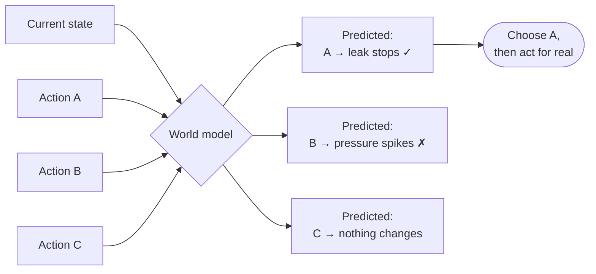
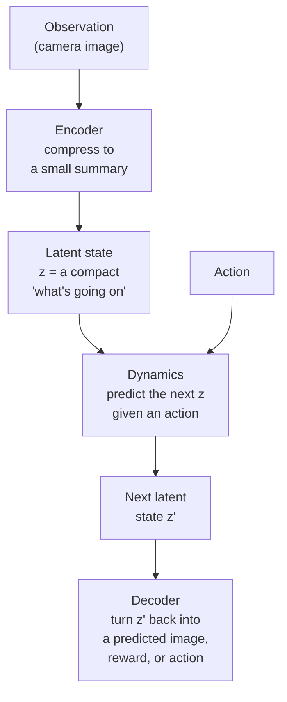
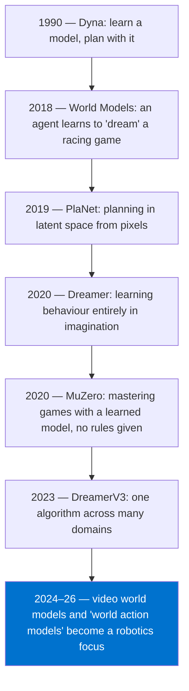
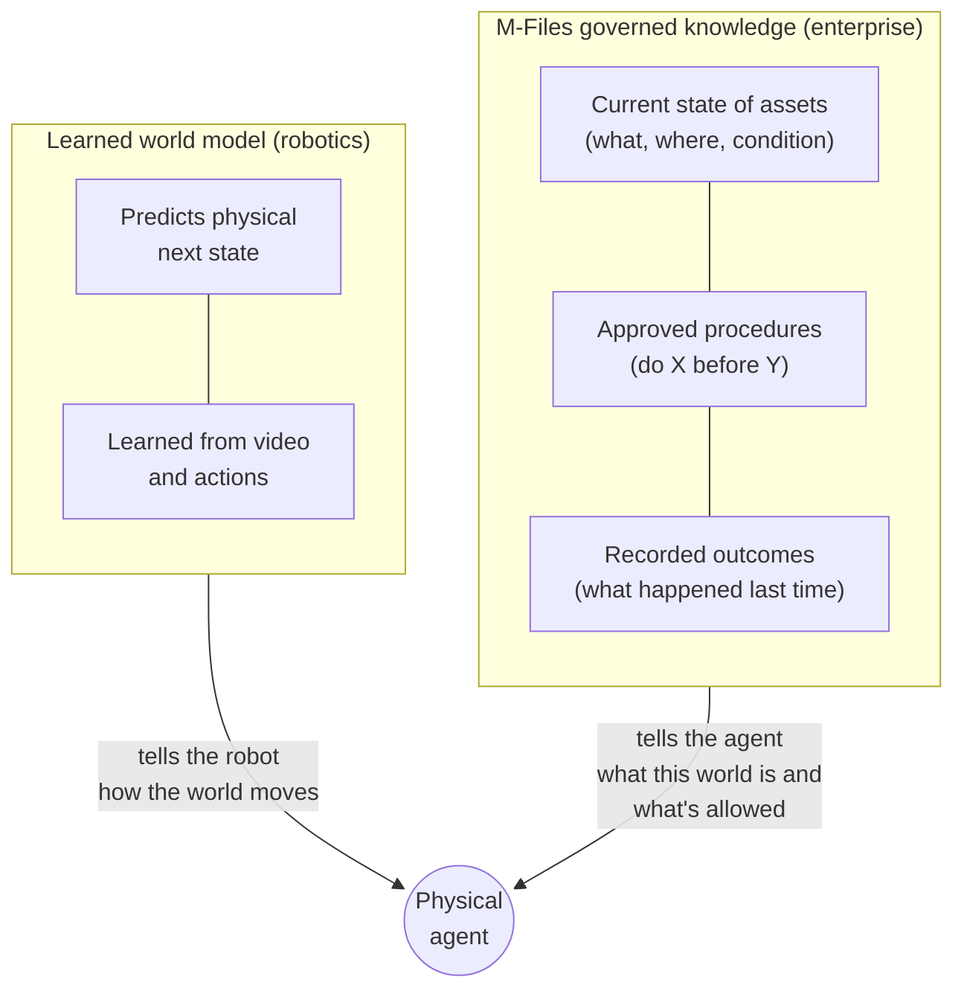

# Chapter 5 — World models: imagining before acting

## Catching a ball

Someone throws you a ball. You don't calculate a parabola. But you don't wait for the ball to arrive and then react either — you'd be far too late. Instead, a fraction of a second after it leaves their hand, your brain has already *imagined* where it will be, and your hand moves there.

You carry a small, fast simulation of the world in your head. You use it to predict what happens next — and what happens *if you act*. If I reach left, the ball lands in my palm. If I don't, it hits my chest.

That internal simulation is what AI researchers call a **world model**.

---

## The formal definition

To formalise: **a world model is a model that predicts how the state of the world will change, given the current state and an action.**

In one line:

```
next_state = world_model(current_state, action)
```

If you have one, you can do something very powerful: **try actions in your imagination before trying them in reality.** That's planning.



---

## How a learned world model works

Modern world models are learned from data — usually video plus actions. They have three parts, and the names are worth knowing because every paper uses them:



1. **Encoder** — squeezes a huge observation (millions of pixels) into a small list of numbers, the *latent state*. Think of it as the model's private shorthand: "arm near cup, cup upright, table clear."
2. **Dynamics** — the heart of it. Given the latent state and an action, predict the next latent state.
3. **Decoder** — optionally turns a predicted latent state back into something checkable: a predicted image, a reward, or an action.

Why not predict pixels directly? Because predicting every pixel of the next frame is enormously expensive and mostly wasted — you don't care about the exact texture of the wall. Predicting in the compact latent space is far cheaper.

---

## A short history



NVIDIA's Jim Fan argues that the successor to today's vision-language-action models will be **world action models** — models that learn physics from vast amounts of cheap video, rather than spending most of their capacity on language [1].

---

## Three things a world model is **not**

This is where most confusion lives.

| Claim | Reality |
|---|---|
| "An LLM is a world model." | An LLM predicts the next **word**. It knows a lot *about* the world from text, but it doesn't predict the next **physical state** after an action. Language knowledge ≠ physics. |
| "A VLA is a world model." | A VLA (Chapter 6) maps observation → action. It may never explicitly predict what happens next. Some do; many don't. |
| "A good video generator is a world model." | Generating plausible-looking video isn't the same as predicting correctly *what your action will cause*. Pretty ≠ right. |

The evaluation question to always ask: **does the model predict the consequences of actions, and how well does that prediction hold up when conditions change?**

---

## Model-free vs. model-based

There are two broad ways to learn to act. This comparison appears in almost every robotics paper:

| | Model-free | Model-based (world model) |
|---|---|---|
| **Idea** | Learn "in this situation, do this" directly by trial and error | Learn how the world works, then plan |
| **Analogy** | Learning to ride a bike by falling a thousand times | Studying how balance works, then practising in your head |
| **Data needed** | Lots | Less (imagination is free) |
| **Weakness** | Data-hungry, brittle when things change | Errors compound — small prediction mistakes snowball over long horizons |
| **Examples** | PPO, SAC | Dreamer, MuZero, TD-MPC |

That last weakness — **compounding error** — is why world models are powerful for short horizons and still risky for long ones.

---

## An enterprise way to think about it

Here's a bridge that's useful for M-Files conversations, and it needs to be stated carefully.

A learned world model predicts *physics*: push the cup, it slides. An enterprise doesn't need M-Files to predict physics. But it does keep a very important kind of structured world knowledge:

- **The current state of the world** — this pump, serial number X, installed on line 3, last serviced in March.
- **Approved expectations about actions** — the maintenance procedure says: close valve V2 *before* removing the seal, or the line will depressurise.
- **The history of what actually happened** — every past repair and its outcome.



These are **not the same thing**, and it would be wrong to call a knowledge graph a world model in the technical sense. But they're complementary halves of what a physical agent needs: one says *how things move*, the other says *what this specific thing is, what state it's in, and what we've agreed is the right way to act on it.* The robotics industry is racing on the first half. The second half is where M-Files lives.

---

> ### Where M-Files stands
> **Not our job to build — but important to understand.** M-Files should never train a learned world model; Google, NVIDIA and others are investing billions there. What M-Files should do is be fluent enough in the concept to position its governed knowledge as the complement: the enterprise's record of asset state, approved procedures, and outcomes. When someone asks "is M-Files building a world model?", the honest answer is: "No — we're building the governed memory a world model's agent consults before it acts."
