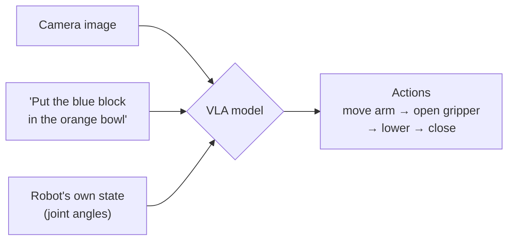
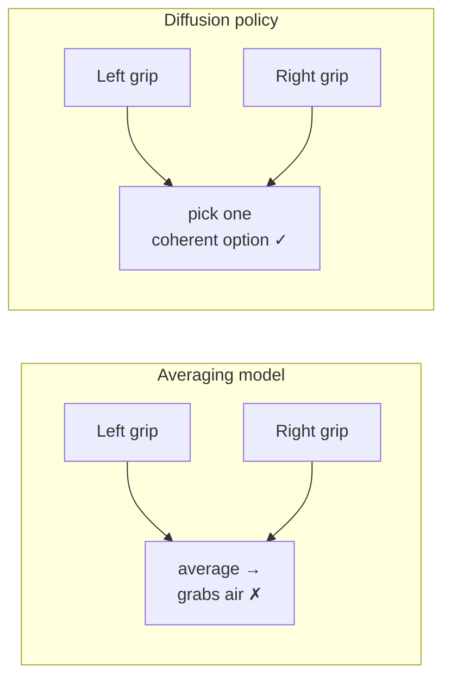
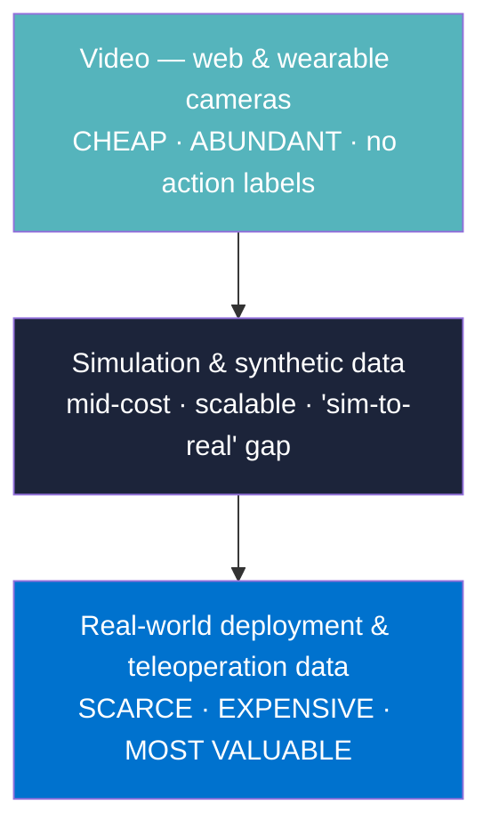
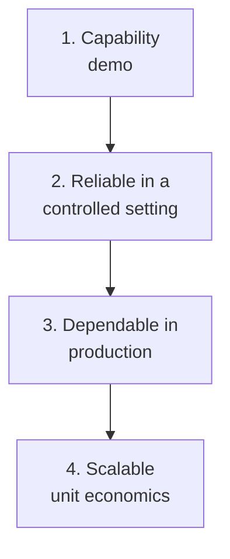
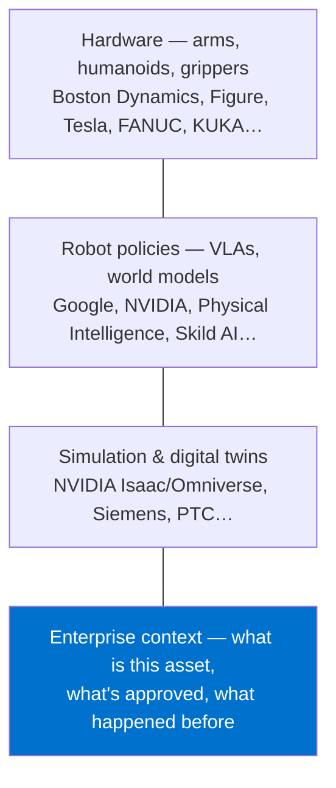

# Chapter 6 — From seeing to doing: how robots learn to act

## Learning to cook by watching

How did you learn to crack an egg? Probably not from a textbook. Someone showed you — maybe a few times — and then you tried, made a mess, and tried again.

Robots learn in the same two ways:

1. **Watching** — copying demonstrations (imitation learning).
2. **Trying** — trial and error with a reward (reinforcement learning).

Modern robot "brains" combine both, plus a third ingredient that changed everything: **pre-training on the internet**, so the robot already knows what an egg *is* before it ever sees one.

---

## The key term: VLA

To formalise: **a vision-language-action model (VLA) takes camera images and a plain-language instruction, and outputs robot actions.**

It's a VLM (Chapter 3) with an extra output: instead of only answering in words, it answers in motor commands.

The family tree:

| Year | Model | What was new |
|---|---|---|
| 2022 | **RT-1** (Google) | One transformer trained on lots of real robot demos, many tasks |
| 2023 | **RT-2** (Google) | Started from a web-trained VLM — the robot inherits internet knowledge |
| 2023–24 | **Open X-Embodiment** | 20+ labs pooled robot data across many robot types |
| 2024 | **OpenVLA**, **Octo** | Open-source VLAs anyone can fine-tune |
| 2025–26 | **Gemini Robotics 2**, **π-series**, others | General-purpose policies, whole-body control, multi-robot coordination |

---

## Two tricks that made VLAs work

### Trick 1 — Action chunks

Instead of predicting one tiny motor command at a time (jerky, slow), models predict a short *chunk* of future actions at once — say, the next half-second of movement. Smoother, faster, and fewer chances to wobble.

### Trick 2 — Diffusion policies

Often there are several good ways to do a task — grab the cup from the left or the right. A normal model averages them and grabs the air in the middle. **Diffusion policies** (borrowing the technique from image generators) produce a *distribution* of possible action sequences and pick one coherent option.

---

## The data problem: the data pyramid

Language models were trained on the whole internet. Robots don't have an internet of robot data. This is the central bottleneck of the field.

Two independent sources describe the same shape. Jim Fan (NVIDIA) calls it a data ladder [1]; McKinsey calls it a data pyramid [5]:

- **Bottom:** human video is everywhere and nearly free, but it shows no robot actions.
- **Middle:** simulation can generate unlimited data, but simulated physics never perfectly matches reality.
- **Top:** real robot data is gold, and painfully slow to collect.

McKinsey adds a reliability ladder that describes how any physical-AI system matures [5]:

Most pilots die between steps 2 and 4. Keep this ladder in mind — it applies to our work too (Chapter 11).

---

## Where reinforcement learning fits (briefly)

Reinforcement learning (RL) is learning from reward: try something, get a score, adjust. It produced famous results in games and simulated robots (DQN, PPO, SAC). In real-world robotics it's usually used to *fine-tune* a policy that was first learned by imitation, because pure trial-and-error on real hardware is slow and can break things.

You don't need to master RL for VMAN Vision. You need to recognise the words and know that "the robot learned it with RL" usually means "in simulation, then carefully transferred" — which is exactly where the sim-to-real gap bites.

---

## What this means for the industry — and for us

The robotics race is being run on these layers:

Every layer above the last one is crowded and extremely well-funded. The last layer — enterprise context — is where a robot or a technician finds out *what this specific machine is and what the approved procedure is*. That's the layer this book keeps returning to.

---

> ### Where M-Files stands
> **Deliberately out of scope — correctly.** M-Files has no robot training data, no robotics team, and no reason to acquire either. The Manufacturing Blueprint's own words set the boundary: M-Files "records outcomes and recommends actions; it does not execute transactions" [10]. Understanding VLAs matters for two reasons only: to speak credibly with robotics partners, and to recognise that every VLA-driven robot in a factory still needs someone to tell it which machine is which and what the approved procedure is.
