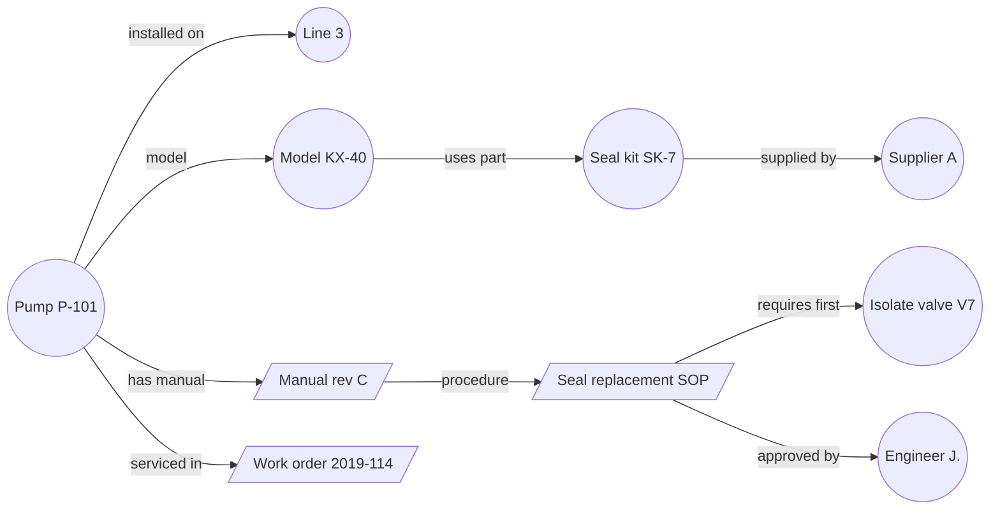
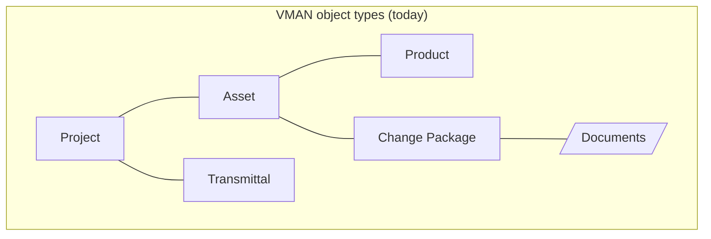
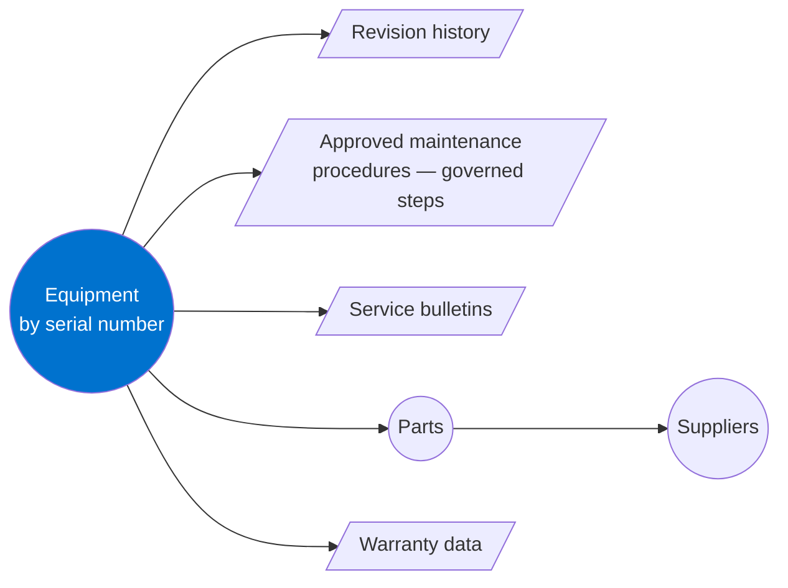
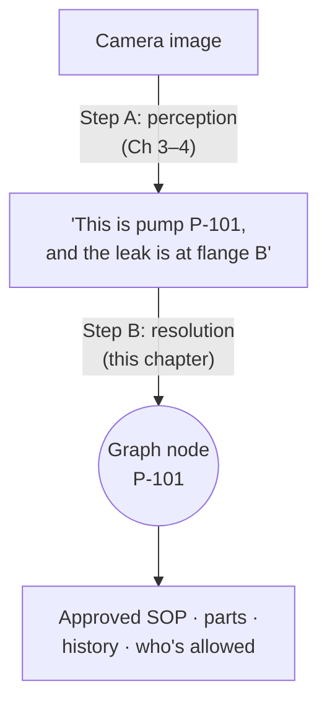

# Chapter 7 — Knowledge graphs: our secret weapon

## The veteran technician

Every plant has one. The person who's been there twenty years. You ask them about a pump and they say:

*"That's the one we replaced in 2019 after the flood. It's the same model as the one on line 2, but the seal kit is different — the supplier changed the part number. And don't forget to isolate V7 first, the drawing's wrong about that."*

Notice what they're doing. They don't recite a document. They **follow connections**: pump → replacement history → sister unit → supplier → part number → procedure → known exception. Their knowledge is a web, not a pile.

That web is a **knowledge graph**. And when that person retires, it's the thing the company most fears losing.

---

## The formal definition

To formalise: **a knowledge graph stores things (nodes) and the named relationships between them (edges), so that knowledge can be followed, queried, and reasoned over — not just searched.**

Every arrow is something a search engine can't easily answer but a graph can: *"Which pumps use seal kits from Supplier A?"* *"What must be isolated before replacing this seal?"* *"Who approved this procedure?"*

---

## Knowledge graph vs. folders vs. vector database

Three ways to organise the same knowledge. This comparison is worth memorising — it comes up in every architecture discussion.

| | Folders | Vector database | Knowledge graph |
|---|---|---|---|
| **Structure** | A tree: one place per file | A cloud of points by meaning | A web of named relationships |
| **Good question** | "Where's the Line 3 folder?" | "Find text similar to 'seal leak'" | "What must I isolate before this repair?" |
| **Strength** | Simple | Fuzzy, semantic search | Precise, explainable, multi-hop |
| **Weakness** | A file lives in only one place | Can't follow relationships; can't say *why* | Needs structure to be defined |
| **Explains its answer?** | — | Rarely | Yes — the path *is* the explanation |

The modern answer is **both**: vector search to find candidates, a graph to follow the relationships and explain the result. This pattern is often called **GraphRAG** (Chapter 8).

---

## M-Files is already shaped like a graph

M-Files doesn't organise by folders. It organises by **objects with metadata**, and **relationships between objects**. Our Product Strategy 2025–26 names this directly — relationships across "documents, projects, people, machines, companies" — and notes that "knowledge graphs are a favored format for AI" [9].

In VMAN, the manufacturing vertical, the object types are already graph-like: Projects, Assets, Products, Transmittals, Change Packages — all linked.

---

## The piece that's planned, not built: Installed Base & Maintenance Knowledge

The Manufacturing Blueprint describes exactly the graph a physical agent would need, and lists it as **planned** [10]:

> Equipment by serial number … approved maintenance procedures as governed steps an assistant renders verbatim.

The 2027 forward-looking thoughts call it "validated design work, not yet built" [11]. As described, it links:

Look at that diagram next to the veteran technician's knowledge at the start of this chapter. It's the same web.

Two phrases in the Blueprint deserve attention:

- **"governed steps an assistant renders verbatim"** — the procedure is not paraphrased by an AI. It's the approved text, shown exactly. That's what makes it safe to put in front of a technician, or a robot.
- **"your systems keep the transaction, M-Files keeps the governed context"** [10] — M-Files isn't replacing the ERP or the maintenance system. It holds the *meaning and the approvals* around them.

---

## Why a physical agent needs this graph

Go back to the goal from Chapter 1: a camera sees a machine, and the system returns the approved procedure. There are two hard steps:

- **Step A — perception** turns pixels into "pump, flange B". That's a vision problem.
- **Step B — resolution** turns "pump" into *the specific node in the graph*: serial number, line, manual revision, permissions. That's a graph problem.

Step B is where most AI demos quietly cheat — they stop at "it's a pump". An enterprise needs "it's *this* pump, and here's *its* approved procedure." Without the graph, the camera sees a pump. With the graph, the agent knows which one.

Today, resolution usually depends on a readable asset tag or serial plate — and the Integration Roadmap scopes tag-to-document linkage for exactly this [12]. The gap vision fills is the case where the tag is worn, painted over, or simply not in view.

---

## How the giants are doing the same thing

We're not the only ones who noticed that physical AI needs a graph:

| Company | Their graph | What they're doing with it |
|---|---|---|
| **SAP** | SAP Knowledge Graph (Sapphire 2026) | Grounding agents in business metadata; a Tetra Pak lab PoC had a humanoid run SAP warehouse workflows guided by that context [13] |
| **Palantir** | Ontology | Models Factory → Line → Machine → Part with live telemetry for maintenance and planning [14] |
| **Siemens** | Digital twins + knowledge graphs | Structures relationships across plant data for AI agents [15] |

Notice the pattern: each of them grounds the agent in **structured, transactional data** — ERP records, sensor telemetry, CAD geometry. Here is where M-Files is different. A great deal of a plant's real knowledge doesn't live in those systems: it lives in manuals, marked-up drawings, SOPs, service bulletins, inspection photos, and approvals — **documents**. That's the content M-Files governs.

---

> ### Where M-Files stands
> **Our strongest card — but half-played.** M-Files already is a graph of documents, people, machines and projects, with governance built in. That is genuinely the memory a physical agent needs, and it covers the document-shaped knowledge the ERP-centred giants handle least well. But the specific graph that matters most — Installed Base & Maintenance Knowledge — is planned, not built, and the engineering-knowledge-graph milestone is H1 2028 [12]. The single most valuable thing this workstream can do is give that planned module a reason to exist sooner: a working demonstration that a camera can resolve to it.
