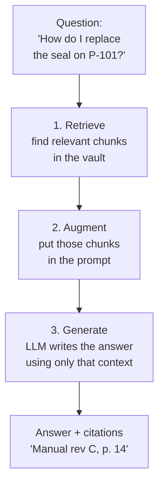
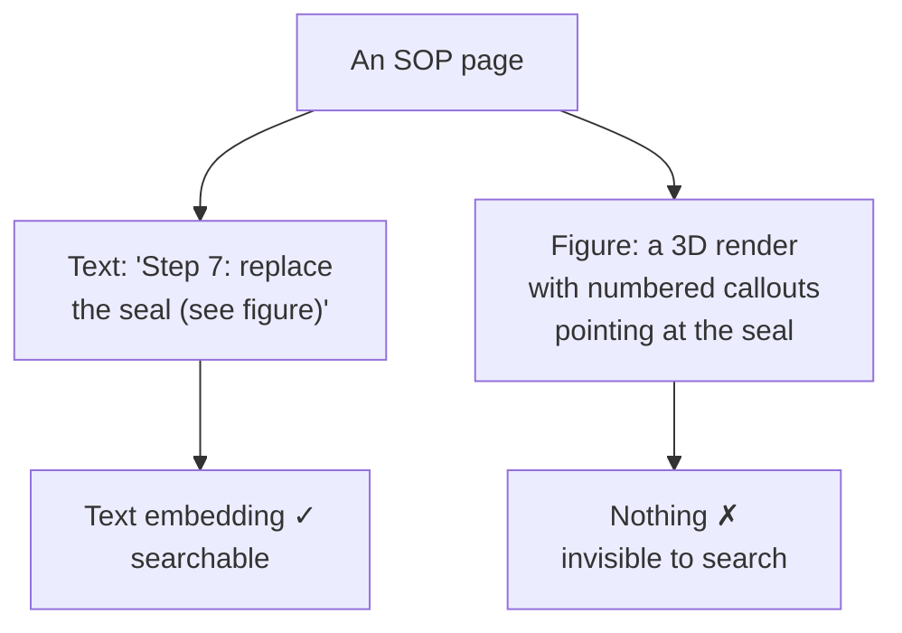
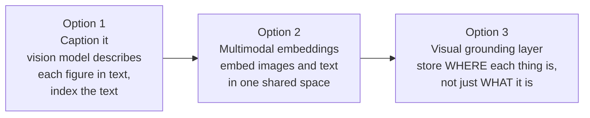
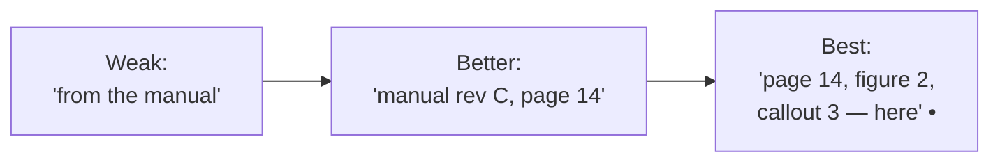
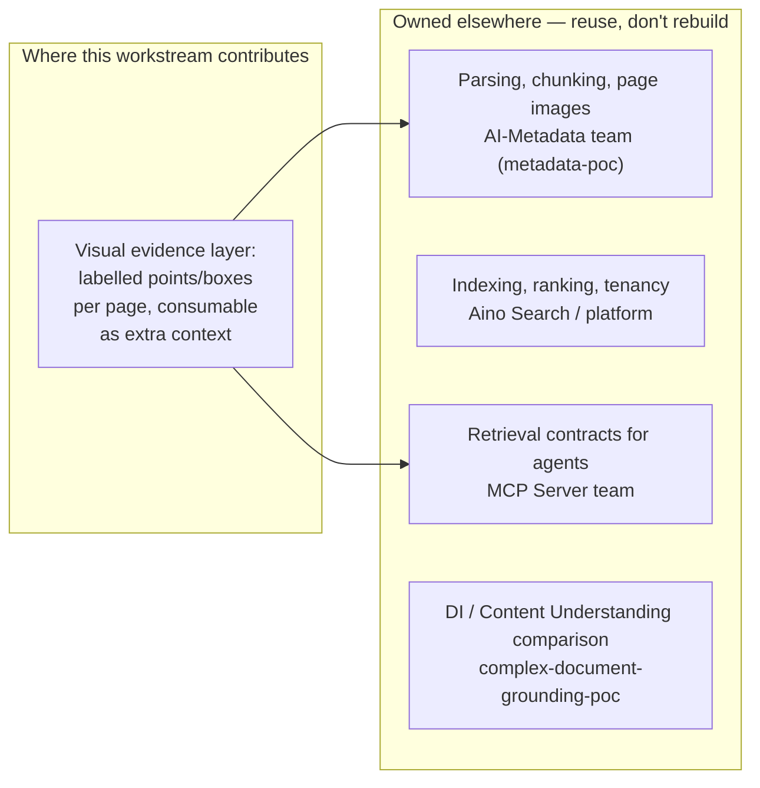

# Chapter 8 — Retrieval that can see

## The open-book exam

Imagine two students sitting an exam. The first has to answer from memory. The second is allowed to bring a textbook, look things up, and — crucially — **cite the page** they got each answer from.

Who do you trust more? The second one, every time. Not because they're smarter, but because you can **check** them.

That's the idea behind **retrieval-augmented generation (RAG)**, and it's why nearly every enterprise AI system is built on it.

---

## RAG in one picture

To formalise: **RAG is a pattern where a system first retrieves relevant pieces of your own content, then gives them to a language model to write an answer grounded in that content.**

The retrieval step usually works like this: every document is split into chunks, each chunk is turned into an **embedding** (a list of numbers representing its meaning — Chapter 3's "meaning space"), and stored in a vector index. A question becomes an embedding too, and the index returns the nearest chunks.

---

## The blind spot: text-only retrieval

Here's the problem. If your embeddings are built from **text**, then anything that isn't text is invisible to search.

The answer to *"which part is the seal?"* is in the figure — and the figure was never indexed. For engineering content, that's often the most important part of the page.

Two specific facts from our own platform:

- **Aino Search is built on text embeddings** (Azure AI Search).
- **Aino's "Images" processing mode** sends page images to the LLM only when files are ≤10 MB; larger files silently fall back to text only (per the AI-Metadata team's workflow documentation, reviewed 2026-09-08). Image-heavy engineering documents are exactly the ones that exceed that.

---

## Three ways to make retrieval see

There's a ladder of options, from cheapest to most capable:

| | 1. Caption, then index | 2. Multimodal embeddings | 3. Visual grounding layer |
|---|---|---|---|
| **How** | A VLM writes a text description of each image; index that | Images and text embedded in the same space (CLIP-style) | Store labelled points/boxes per page alongside the text |
| **Finds** | Images whose *description* matches | Images whose *content* matches | The exact *region* on the page |
| **Can cite a region?** | No | No | **Yes** |
| **Azure-native path** | Azure Content Understanding can generate figure descriptions [18] | Multimodal search in Azure AI Search [18] | Not available off the shelf |
| **Cost** | Low | Medium | Higher |

Options 1 and 2 can be built from Azure services today. Option 3 is where this repository's visual-grounding work contributes — and it's the only option that answers *"show me where"*.

---

## Source attribution: "show me where"

Go back to the open-book exam. Citing "the textbook" is weak. Citing "page 14" is good. Citing **"page 14, the diagram in the top-right, callout 3"** is what a technician actually needs.

Where do these citation levels come from today?

- **Text-level citations** — the sibling repository `complex-document-grounding-poc` has an Azure Document Intelligence adapter that preserves page numbers, text spans and bounding regions for every observation (implemented and offline-tested; live baseline pending).
- **Region-level visual citations** — the review of the AI-Metadata team's design documents found **no** concept of citing back to a location on a page. This is an open gap on both sides.

Visual grounding (Chapter 4) is structurally suited to the "best" level: a point or box on the page *is* a citation.

---

## RAG vs. Agentic RAG vs. GraphRAG

Three variations you'll hear constantly:

| | Classic RAG | GraphRAG | Agentic RAG |
|---|---|---|---|
| **Retrieval** | One search, top-k chunks | Search, then follow graph relationships | An agent decides what to search, when, and whether to search again |
| **Good for** | "What does the manual say about X?" | "What else is connected to X?" | Multi-step questions needing several lookups |
| **Example** | Find the seal procedure | Find the procedure *and* the parts *and* the supplier | "Is this pump's warranty still valid, and if not, who supplies the seal?" |
| **Fit for M-Files** | Today's Aino Search | Natural fit for the metadata graph (Chapter 7) | Natural fit for M-Files agents and MCP (Chapter 9) |

For a physical agent, the natural end state is **agentic GraphRAG over multimodal content**: an agent that can look at a photo, find the right node in the graph, follow its relationships, and cite exactly where each fact came from.

---

## Who owns what (don't build a parallel pipeline)

Retrieval at M-Files is not a blank page. Other teams own large pieces of it, and the repository's own guidance is clear about not duplicating them:

A Q4 planning item — Complex Document Retrieval and Foundation — exists to align the MCP, metadata-agent and platform teams on exactly this boundary.

---

> ### Where M-Files stands
> **Text-strong, picture-blind.** Our search reads words well and ignores what's in figures and drawings — which, for manufacturing content, is often the most important part. Azure offers building blocks for captioning and multimodal search that could be adopted without leaving Microsoft's boundary. What nobody at M-Files has yet is region-level attribution — "it came from here, on this page." That's the capability this workstream's grounding layer is shaped to add, *as input to* the teams who own retrieval, not as a rival to them.
