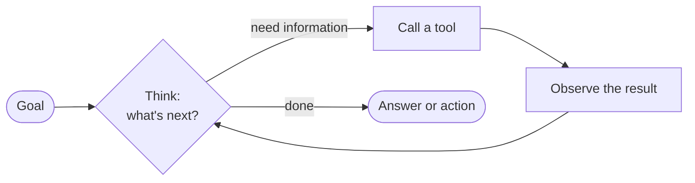
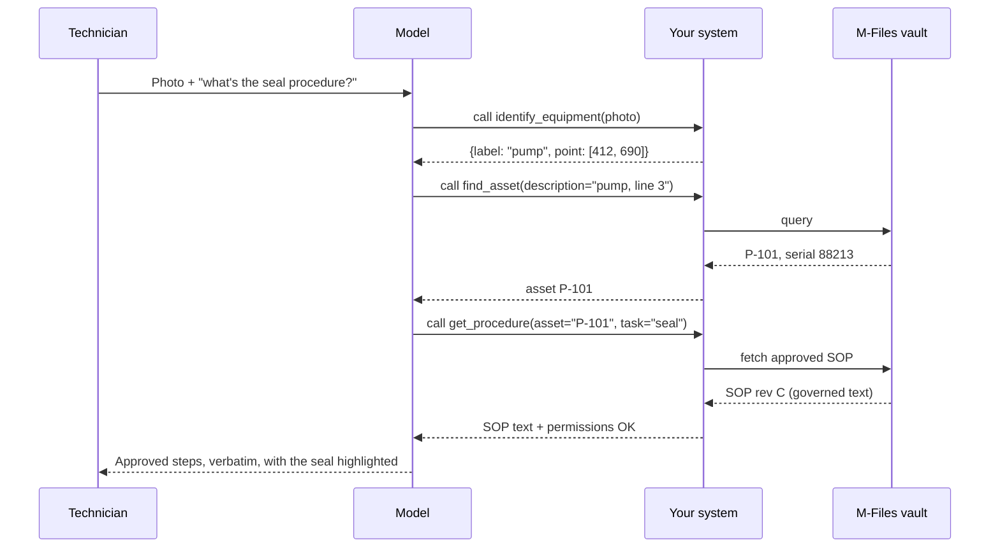
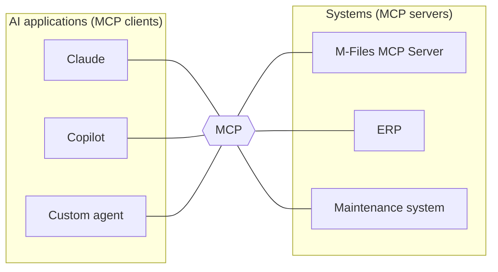
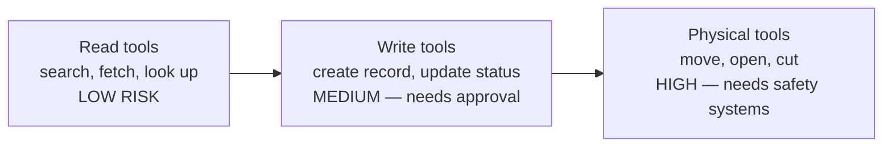

# Chapter 9 — Agents, tools and MCP: giving the brain hands

## The brilliant consultant with no phone

Imagine hiring the smartest consultant in the world, then locking them in a room with no phone, no computer, and no access to your systems. They can give you great general advice. But ask *"what's the stock level of seal kit SK-7?"* and they can only guess.

Now give them a phone and a list of numbers to call: the warehouse, the maintenance system, the document vault. Suddenly they can **look things up and get things done**.

A language model on its own is the consultant in the locked room. **Tools** are the phone. An **agent** is the consultant who knows when to pick up the phone, who to call, and what to do with the answer.

---

## What an agent is

To formalise: **an AI agent is a system in which a language model repeatedly decides what to do next — call a tool, look at the result, decide again — until the goal is met.**



This loop — think, act, observe, repeat — is often called **ReAct** (Reason + Act). It's the same sense → plan → act → check loop from Chapter 2, just running over software systems instead of the physical world.

---

## Tool calling, concretely

A "tool" is just a function the model is allowed to request, described to it in a structured way:

```json
{
  "name": "find_asset",
  "description": "Find an asset in the vault by serial number or description.",
  "parameters": {
    "serial_number": "string (optional)",
    "description": "string (optional)"
  }
}
```

The model never runs code itself. It *asks* for a tool call; your system runs it and returns the result:



Gemini Robotics-ER 2's own quickstart demonstrates exactly this loop — a stateful sequence of function calls, each result fed back to the model — using a mock robot arm [17]. Swap the mock robot functions for vault lookups and it's the diagram above.

---

## Why MCP exists

Every AI application used to wire up its own tools in its own way. Ten apps × ten systems = a hundred custom integrations.

The **Model Context Protocol (MCP)** is a standard plug. A system exposes its tools once, as an **MCP server**; any MCP-capable AI application (**MCP client**) can use them.



To formalise: **MCP is an open protocol that standardises how AI applications discover and call tools, read resources, and use prompts exposed by external systems.**

An MCP server offers three kinds of things:

| Primitive | What it is | M-Files example |
|---|---|---|
| **Tools** | Actions the model can request | Search the vault, fetch an object, read metadata |
| **Resources** | Content the model can read | A document, a procedure |
| **Prompts** | Reusable instruction templates | "Summarise this change package" |

---

## API vs. MCP vs. function calling

People mix these up constantly.

| | Plain API | Function calling | MCP |
|---|---|---|---|
| **What it is** | A system's interface for programs | A model's ability to request a function | A standard for exposing tools to *any* model app |
| **Who uses it** | Developers | One model, inside one app | Any MCP client |
| **Reuse across AI apps** | Build an integration per app | Re-describe tools per app | Build once, reuse everywhere |
| **Relationship** | MCP servers usually wrap APIs | MCP tools are called *via* function calling | The standard on top |

---

## The M-Files MCP Server

M-Files has an MCP Server in private beta, letting AI assistants search and read vault content. Its beta page lists a tracked limitation: **"Image reading is not available in Beta."**

For a physical-agent workflow, that one line matters a lot. In the sequence diagram above, the very first step is a photo. Today, the M-Files MCP Server can serve the *later* steps — find the asset, fetch the procedure — but not the first.

And the market is moving: a construction-drawing vendor (Bluebeam) has already connected its drawing tool to an AI assistant over MCP [20]. "AI + MCP + engineering drawings" is no longer hypothetical in adjacent markets.

---

## The dangerous part: tools that act

Reading tools are low-risk. Tools that **change things** are not. Once an agent can call "create work order" or "move robot arm", every hallucination can become a real-world event.



Three rules of thumb, which Chapter 10 expands:

1. **Least privilege** — an agent gets only the tools and permissions the task needs.
2. **Human approval for writes** — at least until reliability is proven.
3. **Hard limits outside the model** — speed limits, force limits and emergency stops live in the robot's own safety system, never in a prompt.

M-Files' position — "records outcomes and recommends actions; it does not execute transactions" [10] — puts it naturally at the read and record end of this ladder. That's a feature: it's the safest place to be.

---

> ### Where M-Files stands
> **The plumbing exists; the eyes don't.** M-Files has an MCP Server, an AI Foundation platform planning multiple VMAN agents (including a planned Asset Management / Installed Base Intelligence Agent), and a governed vault behind them. The agent pattern needed for VMAN Vision is well understood and already demonstrated by vendors. What's missing is the first link — a tool that takes a photo and returns grounded, resolvable observations — and the product decision to let MCP clients send images at all.
