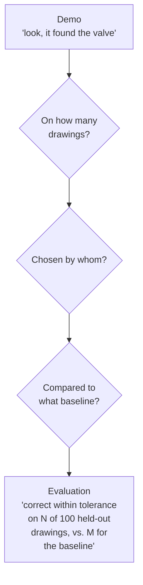
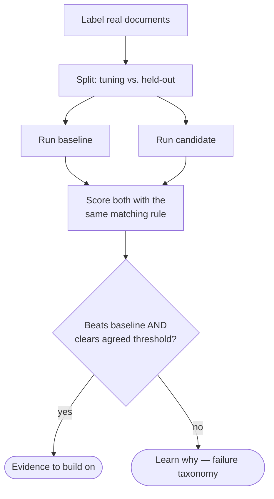
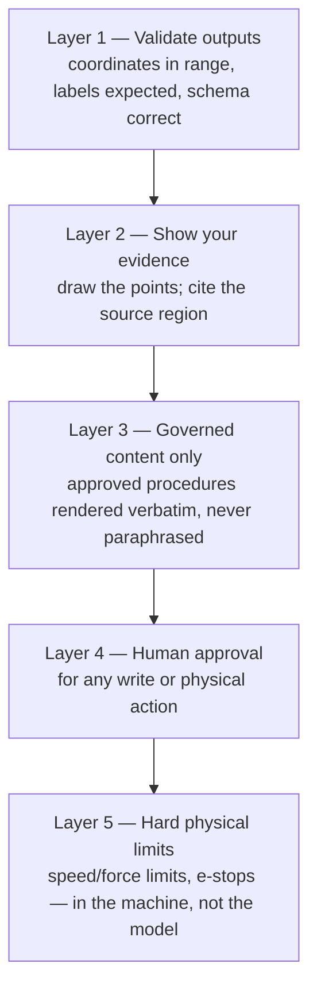

# Chapter 10 — Trust: evaluation, safety and governance

## The new hire's first repair

A new technician finishes their first repair and says *"done."* Would you sign it off without looking? Of course not. You'd check: is the leak gone, were the right parts used, was the procedure followed, was the valve isolated first?

Not because you distrust them personally — because **trust is earned by evidence, and evidence is collected by checking.** AI is no different, except it can be wrong in stranger ways and at far greater speed.

This chapter has three parts: **evaluation** (does it work?), **safety** (what stops it doing harm?), and **governance** (who's allowed, and is it recorded?).

---

## Part 1 — Evaluation: does it actually work?

### Demo vs. benchmark

A demo shows that something *can* work. An evaluation shows *how often* it works, on inputs you didn't hand-pick.

*(N and M are placeholders — no such numbers exist yet for this work.)*

Everything in this repository today is on the left side of that picture. The repository's own documents are explicit: the comparisons are qualitative, and "point count and label specificity do not measure spatial accuracy."

### What a real evaluation needs

To turn a demo into evidence, you need five things:

1. **A labelled set** — a collection of real documents where a human has marked the correct answers (e.g. "the outlet valve is *here*", as a region).
2. **A held-out split** — documents the prompts were never tuned on. Otherwise you're grading your own homework.
3. **A matching rule** — when does a predicted point count as correct? Inside the labelled region? Within 20 units on the 0–1000 grid?
4. **A baseline** — what does the current method (OCR, text-only retrieval) score on the same set?
5. **A threshold agreed in advance** — the repository proposes >90% as a decision criterion, to be set jointly with the teams who'd consume the result, not self-reported.

### The evaluation questions to always ask

Borrowed from robotics research, and just as useful for document AI:

- **What exactly was tested?** Which documents, which model version, which prompt?
- **What counts as a failure?** Wrong location? Malformed output? Missing item?
- **What changed between runs?** Model versions change silently on preview endpoints.
- **What breaks it?** Rotated scans, handwritten markups, low resolution, unusual symbols.
- **Are failures visible?** In our P&ID example (Chapter 4), a model returned coordinates outside the valid grid — a failure that's invisible unless you validate the output.

---

## Part 2 — Safety: what stops it doing harm?

For document assistance, "harm" mostly means wrong information. For physical agents, it can mean injury. The principle is the same: **layers of protection, with the most important ones outside the AI.**

Two of these layers are unusually natural for M-Files:

- **Layer 3** — the Manufacturing Blueprint's phrase "approved maintenance procedures as governed steps an assistant renders verbatim" [10] is a safety design. The AI finds the right procedure; it doesn't rewrite it.
- **Record everything** — M-Files "records outcomes" [10]. An audit trail of what the agent saw, what it recommended, and what was done is the foundation of every incident review.

---

## Part 3 — Governance: who's allowed, and where does the data go?

### Permissions

A technician on line 3 shouldn't see confidential design files for an unreleased product just because they photographed the machine next to it. Every lookup an agent makes must respect the same permissions the person has. M-Files enforces this in the vault already; any new AI path must go through it, not around it.

### Where the data goes

This is the decision that will come up in every stakeholder conversation:

| Option | Where images go | Governance | Grounding quality (in our runs) |
|---|---|---|---|
| **Azure-native** (Foundry, Document Intelligence, Content Understanding) | Stays inside the customer's Microsoft tenant boundary | Easiest to approve; aligned with our strategy [9] | Good for text/layout; weaker at precise pointing |
| **Gemini Robotics-ER 2 via Google API** | Sent to Google | Needs an approved external dependency | Strongest pointing we've observed — preview model |
| **Gemini as offline benchmark only** | Only approved test data goes to Google | Low risk | Used to *measure* Azure options, not in production |
| **Microsoft Magma-8B on Foundry Managed Compute (preview)** | Stays in our Azure subscription, on dedicated GPUs | Only if available in our project/region; needs a GPU quota request; model card excludes production use | Untested here; strongest published icon grounding in its paper |
| **Self-hosted open model** (e.g. Magma weights on our own GPU) | Your own machine | Full control | Untested here; operational cost |

The repository's recommended stance is **start Azure-native**, and use Gemini-style grounding as a benchmark or add-on for the visual cases Azure can't yet solve [18].

### Vendor-specific rules worth knowing

From Google's documentation, checked 2026-09-18 [17]:

- **Unrestricted API keys are rejected** — keys must be restricted in AI Studio. Never commit a key to Git (this repository's `.env` is gitignored for exactly this reason).
- **The Interactions API stores requests by default.** Use `store=false` where data-handling policy requires stateless requests.
- **Video and audio with identifiable people** require notice, consent and minimisation. Don't use people-containing media in any experiment without an approved privacy plan.
- **ER 2 is a preview endpoint** — output format and behaviour can change without notice. Pin versions and re-run evaluations when they change.

### Customer data in repositories

This repository learned this the practical way: customer drawings were removed from the demo in favour of public, licence-tracked fixtures (`fixtures/public-fixtures.json`) — but files that were committed earlier still exist in the private Git history. Treat that as a standing rule: **never commit customer content to a research repository in the first place**, because removing it later doesn't erase it.

---

> ### Where M-Files stands
> **Governance: strong. Evaluation: missing.** M-Files' permissions, verbatim governed content, and audit trail are exactly the safety properties physical agents need — a genuine competitive advantage. But there is no labelled evaluation set, no scoring rubric, and no measured accuracy anywhere in this work yet. Until there is, every claim must be phrased as "demonstrated on these examples", never "works". Building a small, labelled, held-out evaluation set is the highest-leverage next step after the first demo — and it's what turns a prototype into something a product owner can commit to.
