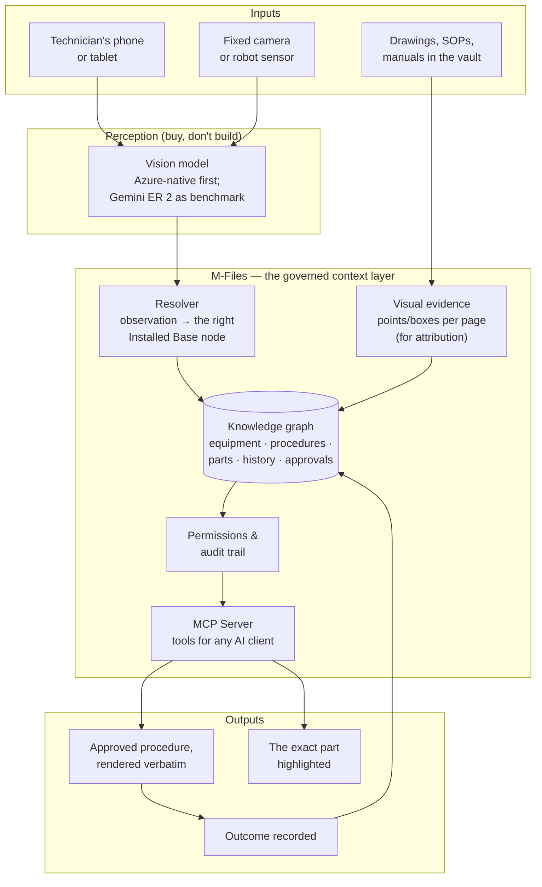
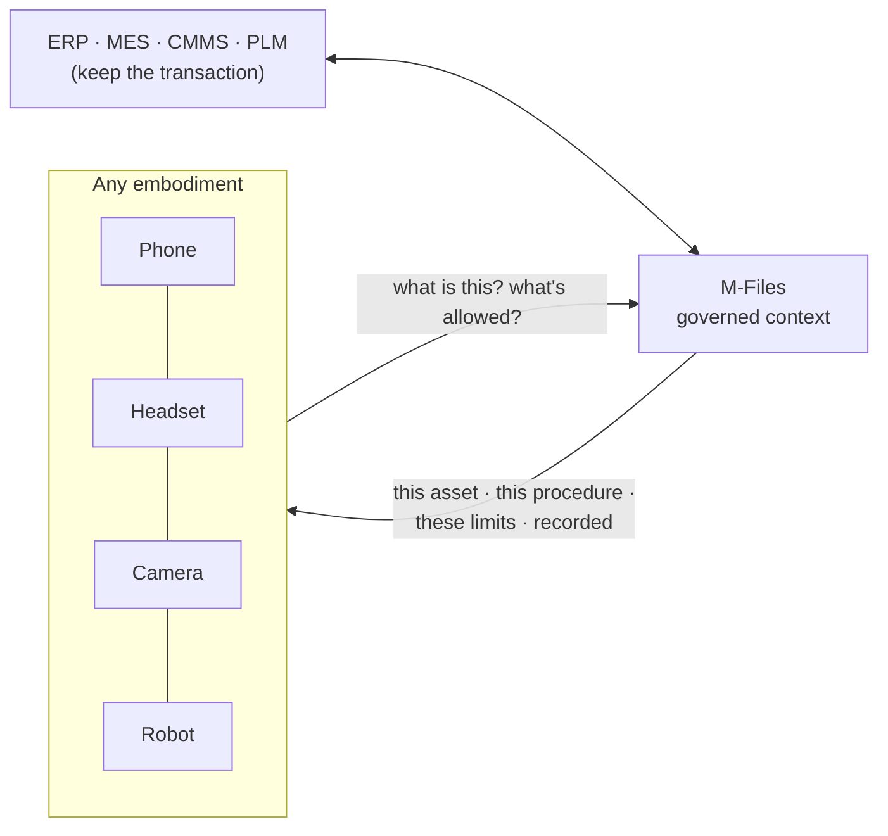
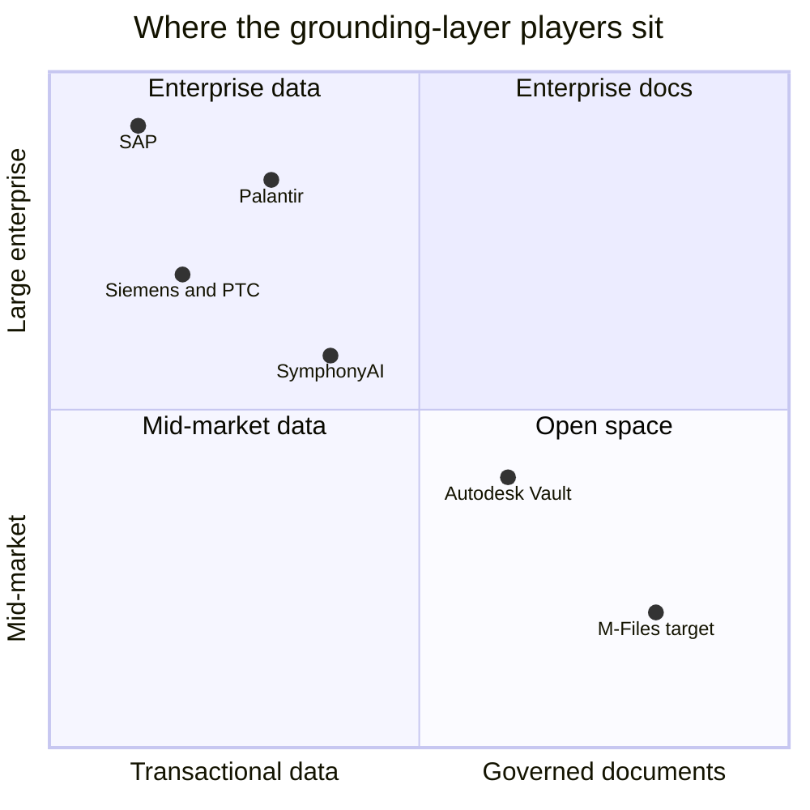
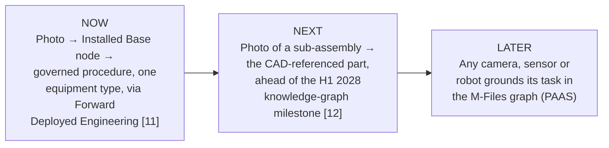

# Chapter 11 — Putting it together: VMAN Vision

## Assembling the pieces

Every chapter so far has handed you one piece:

| Piece | Chapter | M-Files today |
|---|---|---|
| Eyes — see the scene | 3 | Missing (buyable) |
| Finger — point at the exact thing | 4 | Prototype only |
| Memory — know which thing it is | 7 | Strong shape; key module planned |
| Search — find the right content | 8 | Text-only |
| Hands — call the right systems | 9 | MCP exists; no image input |
| Judgement — check it's right and allowed | 10 | Governance strong; evaluation missing |

This chapter assembles them into one architecture, places it in the market, and lays out how to get there step by step.

---

## The architecture

Three design choices are baked into that picture:

1. **Perception is bought, not built.** The vision model is a replaceable component behind an interface — which is exactly how `prototype/providers/` is already structured.
2. **M-Files owns resolution and governance.** The step from "a pump" to "*this* pump, *its* approved procedure, *your* permission to see it" is the defensible part.
3. **M-Files never executes.** It recommends, renders, and records. The customer's own systems — or a partner's robot and its safety systems — do the transaction [10].

---

## Physical Agents as a Service

Stretch that architecture forward and you get the long-term idea from the pitch: **Physical Agents as a Service (PAAS)**. Any embodiment — a phone, a headset, a fixed camera, a robot arm, a humanoid — asks M-Files the same question: *"what is this, what's its state, and what's the approved way to act on it?"*

"We don't build robots. We become the layer every robot needs before an enterprise will trust it with a task." That sentence is consistent with the Blueprint's non-compete stance — the Blueprint's own line, "your systems keep the transaction, M-Files keeps the governed context" [10], is PAAS in one clause.

---

## The competitive landscape

Honesty first: M-Files is **not** early to the idea of grounding physical AI in enterprise data.

| Player | What they're doing | Grounded in | Threat or partner? |
|---|---|---|---|
| **SAP** | Knowledge Graph + embodied-AI pilots (Tetra Pak lab PoC with a humanoid running warehouse workflows) [13] | ERP transactions | Partner-shaped: they keep the transaction |
| **Palantir** | Ontology of factory → line → machine → part with telemetry [14] | Sensor/operational data | Competes for "the context layer" at large enterprises |
| **Siemens, PTC, Dassault** | Digital twins wired to NVIDIA simulation via OpenUSD [15] | CAD geometry & simulation | Partner-shaped: CAD/PDM we "wrap around, not replace" [12] |
| **SymphonyAI IRIS Foundry** | VLM P&ID extraction matched to CMMS/EAM asset graphs | Industrial asset systems | Closest direct analog — for asset systems, not a document vault |
| **Autodesk Vault 2027 Assistant** | Conversational AI over vault metadata | Existing vault metadata (not pixels) | Raises the bar: "chat with your vault" alone is no longer differentiated |
| **Drawing-AI point solutions** (DiagramIQ, Pathnovo, LlamaParse…) | VLM-based drawing digitisation | The drawing itself | Reading drawings with a VLM is no longer novel |

Sources for the last three rows: `pitch/README.md` "Pitch-relevant updates" and `RESEARCH_LOG.md`, 2026-08-23 to 2026-08-26.

**So where's the open space?** Every player above grounds agents in *structured transactional data* or in *the drawing alone*. No one found so far does it for a **governed, general-purpose document and records vault** — the manuals, SOPs, marked-up drawings, bulletins and approvals where much of a plant's real operational knowledge lives. And the CAD Integration Roadmap already points M-Files at **SMB and mid-market first** [12] — customers who will never run a Palantir-scale ontology programme.

*(Positions are qualitative judgements for discussion, not measurements.)*

---

## Start small, land big

The McKinsey reliability ladder from Chapter 6 — demo → controlled reliability → production dependability → unit economics — maps directly onto a sequence of steps, each one tied to something already on M-Files' own roadmap:

| Step | What gets built | Depends on | McKinsey rung |
|---|---|---|---|
| **Now** | One equipment type, one pilot customer: photo in, correct asset + verbatim procedure out, plus a labelled evaluation set | Blueprint entity model [10]; Forward Deployed Engineering route [11] | 1 → 2 |
| **Next** | Extend resolution to CAD/PDM-linked components; boxes and crop-and-re-inspect | CAD Integration Roadmap [12] | 2 → 3 |
| **Later** | Embodiment-agnostic API; first robotics or platform partner | Proven resolution + partner | 3 → 4 |

Each step is small enough to be approved on its own and produces evidence the next step needs.

---

## Questions a product owner will ask (and honest answers)

| Question | Honest answer |
|---|---|
| "Are we building a robotics product?" | No. M-Files recommends and records; it never executes [10]. The embodiment is the customer's or a partner's. |
| "Doesn't Document Intelligence already do this?" | It extracts text and layout with reliable citations, and should be the foundation. It doesn't locate symbols or answer visual questions. Complementary, not duplicate (Chapters 4, 8). |
| "Why not just use Gemini?" | Strongest pointing we've observed, but a preview endpoint outside Microsoft's boundary. Start Azure-native; use Gemini as a benchmark (Chapter 10). |
| "How accurate is it?" | Unknown. Everything so far is qualitative. The first deliverable should include a labelled evaluation set (Chapter 10). |
| "Isn't the Installed Base module 2027–28 work?" | It's validated design, not yet built [11]. A working photo-to-node demo is a concrete reason to pull part of it forward. |
| "Who else is doing this?" | SAP, Palantir, Siemens and others for structured data; point solutions for drawings. Nobody found yet for a governed document vault (see table above). |

---

> ### Where M-Files stands
> **A credible, differentiated position that is still mostly on paper.** The architecture uses M-Files' real strengths (the graph, governance, the partner-shaped non-compete stance) and buys what it lacks (perception). The competitive gap — grounding physical agents in governed *documents* rather than transactions — is real but will not stay open forever. The path from here is deliberately small: one equipment type, one pilot, one labelled evaluation set, delivered through a route M-Files already sanctions.
