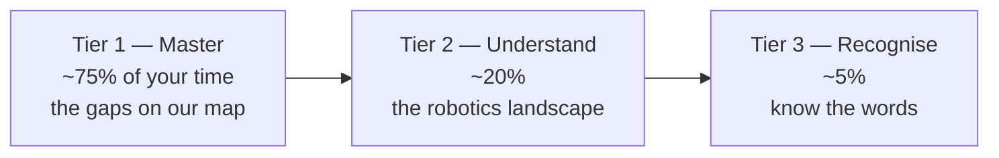
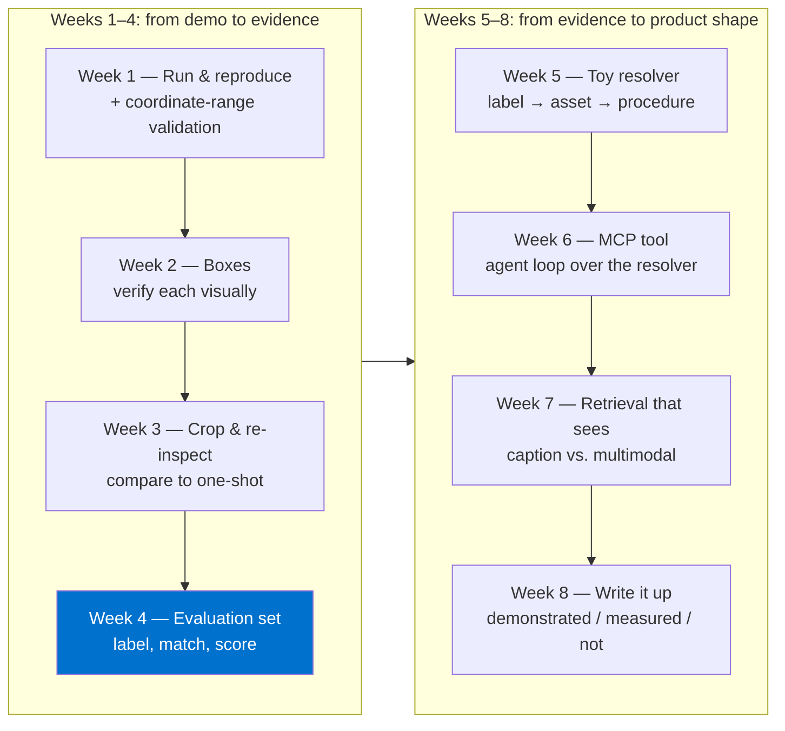

# Chapter 12 — The hero's path: a curriculum

## Learning to swim

Nobody learns to swim by reading about fluid dynamics. You get in the shallow end, you splash, you learn one stroke, then another, and eventually the deep end stops being scary.

This chapter is the shallow-to-deep path. It's re-weighted from the earlier six-page personal guide this book grew out of, which was a general robotics curriculum (control theory, reinforcement learning, simulators). Chapter 1's map showed that M-Files' real gaps are **seeing, pointing, retrieving, remembering and proving** — so that's where most of the time goes now.

---

## Tier 1 — Master these

### 1.1 Vision and VLMs (Chapter 3)

- **Read:** *Attention Is All You Need* ([arXiv 1706.03762](https://arxiv.org/abs/1706.03762)), *Vision Transformer* ([arXiv 2010.11929](https://arxiv.org/abs/2010.11929)), *CLIP* ([arXiv 2103.00020](https://arxiv.org/abs/2103.00020)).
- **Course:** [Stanford CS231n](https://cs231n.stanford.edu/) (vision) — the lectures on CNNs, transformers and vision-language models.
- **You're done when:** you can explain to a colleague why a VLM can describe a P&ID but OCR can't — and name three ways VLMs fail.

### 1.2 Spatial grounding (Chapter 4)

- **Read:** Google's [Gemini Robotics overview](https://ai.google.dev/gemini-api/docs/robotics-overview) and the [ER 2 quickstart notebook](https://github.com/google-gemini/robotics-samples/blob/main/Getting%20Started/gemini_robotics_er.ipynb); this repository's `docs/gemini-robotics-model-guide.md`.
- **Read:** *Magma* ([arXiv 2502.13130](https://arxiv.org/abs/2502.13130)) — Microsoft's mark-based alternative — then this repository's `docs/magma-readiness.md`.
- **Do:** run the demo (Chapter 13), then reproduce the P&ID comparison from Chapter 4.
- **You're done when:** you can convert `[y, x]` on the 0–1000 grid to pixels in your head, and explain point vs. box vs. crop-and-re-inspect.

### 1.3 Retrieval and RAG (Chapter 8)

- **Read:** the original *RAG* paper ([arXiv 2005.11401](https://arxiv.org/abs/2005.11401)); Microsoft's *GraphRAG* ([arXiv 2404.16130](https://arxiv.org/abs/2404.16130)); Azure's [multimodal search overview](https://learn.microsoft.com/azure/search/multimodal-search-overview).
- **Also excellent:** the RAG and Context Engineering chapters of *AI Engineering: System Design Patterns for LLMs, RAG and Agents* (Daily Dose of Data Science, 2025) — the book whose style this one borrows.
- **You're done when:** you can draw classic RAG, GraphRAG and agentic RAG from memory and say which fits which M-Files question.

### 1.4 Knowledge graphs (Chapter 7)

- **Read:** this repository's Chapter 7, then the Manufacturing Blueprint [10] and Product Strategy 2025–26 [9] on Confluence.
- **You're done when:** you can sketch the Installed Base & Maintenance Knowledge graph and explain the difference between perception and resolution.

### 1.5 Agents, tools and MCP (Chapter 9)

- **Read:** *ReAct* ([arXiv 2210.03629](https://arxiv.org/abs/2210.03629)); the [Model Context Protocol documentation](https://modelcontextprotocol.io/); the Agents and MCP chapters of *AI Engineering* (above).
- **You're done when:** you can write a tool description, trace an agent loop step by step, and explain API vs. function calling vs. MCP.

### 1.6 Evaluation and trust (Chapter 10)

- **Read:** the evaluation plan in the sibling repository (`complex-document-grounding-poc/docs/evaluation-plan.md`) and this repository's comparison docs, paying attention to how they phrase limitations.
- **You're done when:** you can design a labelled evaluation for point grounding — matching rule, held-out split, baseline, threshold — on one page.

---

## Tier 2 — Understand these

### 2.1 World models (Chapter 5)

- **Read, in order:** *World Models* ([arXiv 1803.10122](https://arxiv.org/abs/1803.10122)), *DreamerV3* ([arXiv 2301.04104](https://arxiv.org/abs/2301.04104)).
- **Watch:** Jim Fan, "Robotics' End Game" (Sequoia AI Ascent 2026) [1].
- **You're done when:** you can explain encoder → latent state → dynamics → decoder, and why an LLM isn't automatically a world model.

### 2.2 VLAs and robot learning (Chapter 6)

- **Read:** *RT-2* ([arXiv 2307.15818](https://arxiv.org/abs/2307.15818)), *OpenVLA* ([arXiv 2406.09246](https://arxiv.org/abs/2406.09246)), *Diffusion Policy* ([arXiv 2303.04137](https://arxiv.org/abs/2303.04137)).
- **Watch:** McKinsey Live, "Physical AI's Hidden Value Pools Leaders Miss" (Sept 2026) [5] — for the data pyramid and reliability ladder.
- **You're done when:** you can explain action chunks, diffusion policies and the data pyramid to a product manager.

---

## Tier 3 — Recognise these

You don't need to study these for VMAN Vision. You need to recognise the words when a robotics partner uses them.

| Topic | One-line meaning | If you ever go deeper |
|---|---|---|
| PID / LQR / MPC | Classic ways to control a machine from its sensors | [MIT Underactuated Robotics](https://underactuated.mit.edu/) |
| Kalman filter | Estimating true state from noisy sensors | Same as above |
| Kinematics / inverse kinematics | Joint angles ↔ where the hand ends up | *Modern Robotics* (Lynch & Park) |
| PPO / SAC | Popular reinforcement-learning algorithms | [Berkeley CS285](https://rail.eecs.berkeley.edu/deeprlcourse/) |
| Sim-to-real | Transferring a policy from simulation to hardware | [NVIDIA Isaac Lab](https://isaac-sim.github.io/IsaacLab/) |
| MuJoCo | A standard physics simulator for research | [mujoco.org](https://mujoco.org/) |

---

## The capstone ladder (8 weeks, M-Files-shaped)

Each capstone produces **evidence**, following this repository's conventions (see `AGENTS.md` and the `physical-agent-experiment` skill — load it before starting any new experiment). Use public, licence-tracked fixtures only.

| Week | Build | Evidence to keep |
|---|---|---|
| 1 | Reproduce the demo; reject coordinates outside 0–1000 | Test for the validation; before/after overlays |
| 2 | Box output on public fixtures | Raw responses, overlays, visual verification notes |
| 3 | Crop and re-inspect | One-shot vs. crop answers side by side |
| 4 | Labelled evaluation set + scoring script | Labels, matching rule, per-model scores, failure list |
| 5 | Toy Installed Base resolver | The mini graph, resolver tests, example runs |
| 6 | Resolver exposed as an MCP tool | Tool schema, agent-loop transcript |
| 7 | Caption vs. multimodal retrieval | Queries, results, which one found the right figure |
| 8 | Evidence write-up | A doc in `docs/`, labelled demonstrated / measured / untested |

Week 4 is the most important week on this list. Everything after it can be measured; everything before it is a demo.

---

## Final advice

The shortest route to real competence is not chasing the newest model name. It's learning to say, precisely:

- **What** the model was asked,
- **Where** its answer points,
- **Which** object in our graph that resolves to,
- **How often** it's right, measured, and
- **Who** is allowed to see and act on it.

Get those five right and the model becomes a replaceable part. That's exactly the position M-Files wants to be in.
