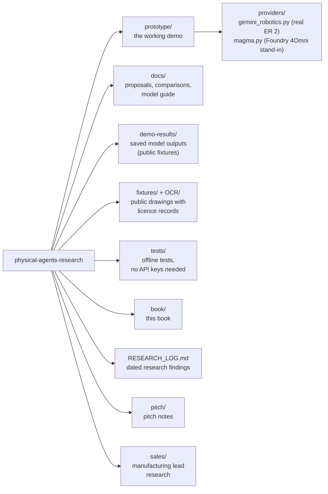
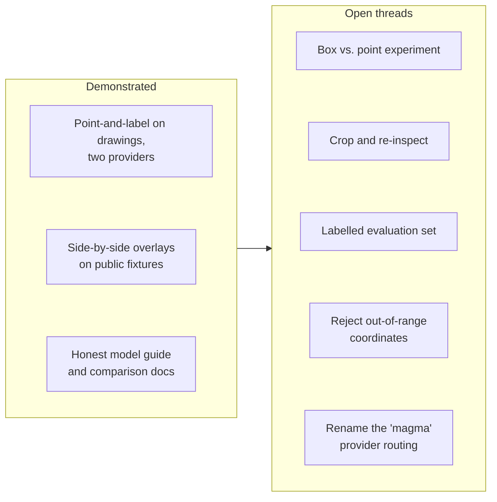
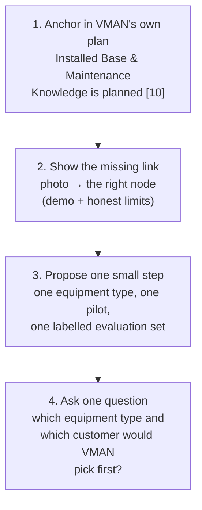

# Chapter 13 — The handover: your first week

*Written 28 September 2026 for Ankit, taking over from Viditya while he's away (1–6 October). Dates and statuses below are as of that day — check `git log` and the PR list for anything newer.*

## The relay race

In a relay, the baton handover is where races are won and lost. The incoming runner starts moving *before* the baton arrives, so there's no standing start. This chapter is designed to give you that running start: where everything is, what's proven, what's open, and who's who.

---

## The repository in one picture



| Path | What it is | Read it when |
|---|---|---|
| `AGENTS.md` | The rules for every contributor and coding agent | **First, before any change** |
| `prototype/` | Flask web demo + CLI; providers isolated under `providers/` | You want to run or change the demo |
| `docs/gemini-robotics-model-guide.md` | What Google's models can and can't do, with sources | Before any model conversation |
| `docs/complex-document-retrieval-visual-grounding-proposal.md` | The "visual evidence layer" proposal and experiment design | Before talking to retrieval/MCP teams |
| `docs/differentiation-plan-vs-metadata-poc.md` | Where we do and don't overlap with the AI-Metadata team | Before proposing anything to them |
| `docs/*-comparison.md` | Gemini vs. Foundry qualitative comparisons | When someone asks "which model?" |
| `RESEARCH_LOG.md` | Dated findings from the research routine | To catch up on the market |
| `pitch/README.md` | Pitch-relevant updates, including competitor corrections | Before any stakeholder pitch |

---

## Running the demo (about 15 minutes)

```bash
cp .env.example .env
```

Fill in `GEMINI_API_KEY` (and `FOUNDRY_API_KEY`, `FOUNDRY_ENDPOINT`, `FOUNDRY_DEPLOYMENT` for the Azure provider). Ask Viditya for access rather than creating new keys; never commit `.env`.

```bash
pip install -r prototype/requirements.txt
```

```bash
python -m prototype.server
```

Open `http://127.0.0.1:5000`, pick a public sample, choose a provider, run it. Points are drawn back onto the drawing next to the raw JSON.

Two things to know:

- **Results are cached** in `.vman-vision-cache/` (gitignored) — re-running the same file + provider + prompt costs no tokens.
- **The latest result per document is written to `demo-results/`**, which *is* tracked. Before committing, check nothing from a non-public upload landed there.

Run the offline tests (no keys needed):

```bash
python -m pytest tests -q
```

---

## The rules that matter most

From `AGENTS.md`, in order of how often they'll matter:

1. **Topic branch → pull request → Viditya (or the owner) merges.** Never push code to `main`. No auto-merge.
2. **No customer content, credentials, raw provider output or unapproved overlays in Git.** Public, licence-tracked fixtures only. (Customer files removed from the working tree earlier still exist in private history — don't add more.)
3. **Treat model output as experimental evidence.** Report failure modes; never invent confidence values.
4. **Label every claim:** demonstrated, documented, or hypothesis (see the book's README).
5. **Scope:** complex-document comparisons (Document Intelligence, Content Understanding, metadata integration) live in `complex-document-grounding-poc`, not here.

The repository also defines three agent roles (`.github/agents/`, mirrored in `.claude/agents/`): `research-producer`, `physical-agent-developer`, `experiment-qa`, and a `physical-agent-experiment` skill to load before any new experiment.

---

## What runs on its own

Three scheduled cloud routines run under Viditya's account and write to this repository:

| Routine | When (UTC) | What it does |
|---|---|---|
| Biweekly Physical Agents Research | 18:30 on the 1st and 15th of each month | Appends a dated entry to `RESEARCH_LOG.md`; pushes to `main` (allowed exception) |
| Weekly Physical Agents Repo Update | Sundays 19:00 | Synthesises the week's log; opens a PR only if something justifies a change |
| Weekly Manufacturing Win Strategist | Sundays 20:00 | Updates `sales/manufacturing/` lead profiles |

The research routine moved from nightly to **biweekly on 18 September**, so there were no research entries between 17 September and 1 October — that's expected. The next one runs **1 October**. (The 27 September weekly synthesis flagged the silence as a possible fault; it isn't.)

---

## What's proven, and what's open



| Open thread | Why it matters | Where to start |
|---|---|---|
| **Labelled evaluation set** | Nothing is measurable without it (Chapter 10) | Capstone week 4 (Chapter 12) |
| **Box vs. point** | The next rung of grounding (Chapter 4) | The proposal doc's "Scoped follow-up" section |
| **Crop and re-inspect** | Fixes small-detail failures | Same section |
| **Out-of-range coordinates** | Foundry returned x = 1050 / 1100 on the P&ID fixture; the overlay silently clamps them (Chapter 4) | `prototype/overlay.py` `_to_pixels`, plus a test |
| **`magma` naming** | The provider is Azure Foundry `4Omni`, not Microsoft Magma — the name misleads | `prototype/providers/magma.py` and demo routing |
| **Resolver prototype** | The core M-Files differentiator (Chapter 7) has no code yet | Capstone week 5 |
| **First real Magma run** | Magma-8B is listed in the Foundry catalog. It may be deployable inside Azure on Foundry Managed Compute (preview), depending on project, region and quota. It's the Microsoft-native grounding candidate | First check **Available in my Project** in Foundry; then `docs/magma-readiness.md` §9–10; rename the `magma` provider first |

---

## Who's who

| Person / team | Role in this story |
|---|---|
| **Rajat Singh** | VMAN Product Owner |
| **Matti Kurittu** | VMAN Team Architect |
| **Ville Somppi** | Owner of the Manufacturing Blueprint page [10] |
| **Sivaram Reddy** | Author of the CAD Integration Roadmap 2026–2029 [12] |
| **Tony Grout** | Author of the Product Strategy 2025–26 blog [9] |
| **Vatsal Kariya** | MCP Server; owns the beta page with the image-reading limitation |
| **AI-Metadata team** | Owns metadata extraction (`metadata-poc`, parsing engine) |
| **Q4 "Complex Document Retrieval and Foundation" group** | Vatsal Kariya, Antti Nivala, Raphaël Allègre, Brian Remmington — aligning MCP, metadata-agent and platform on complex-document retrieval |

---

## Preparing for a conversation with the VMAN Product Owner

A conversation with Rajat Singh is planned for 7 October. You don't need to pitch the whole vision — you need to connect it to what VMAN already plans.



Five sentences to have ready:

1. *"We're not proposing a new product — we're proposing the perception link for the Installed Base module your Blueprint already plans."*
2. *"M-Files keeps the governed context and records outcomes; it never executes — that's straight from the Blueprint."*
3. *"The demo shows it can point at the right thing on real engineering drawings. We haven't measured accuracy yet; the first deliverable would include a labelled evaluation set."*
4. *"Azure-native first. Gemini is our benchmark, not a dependency."*
5. *"Forward Deployed Engineering is the route — one real customer, one equipment type."*

Viditya holds the pitch deck and the one-page summary outside this repository; ask him for the latest versions before the meeting.

---

## Keeping this book current

The book is published in numbered volumes. You're reading Volume 2, and every past volume's PDF is kept in `book/volumes/`. When you change something substantive — a new section, or a fact that changes a conclusion — cut a new volume:

1. Bump `book/volume.json`.
2. Update the volume line in `book/README.md`.
3. Add a row to [VOLUMES.md](VOLUMES.md).
4. Run `python book/tools/build_pdf.py --release`.

Typo fixes don't need a new volume.

---

## If you get stuck

- **A claim you're unsure of** — check [Appendix B](appendix-b-sources.md) for its source and verification date. If it's older than a month, re-verify before repeating it.
- **A model behaves oddly** — ER 2 is a preview endpoint; check whether the model version changed before debugging your code.
- **A scope question** — `AGENTS.md` "Purpose and boundaries" first; then ask Viditya on his return.

Welcome aboard.
