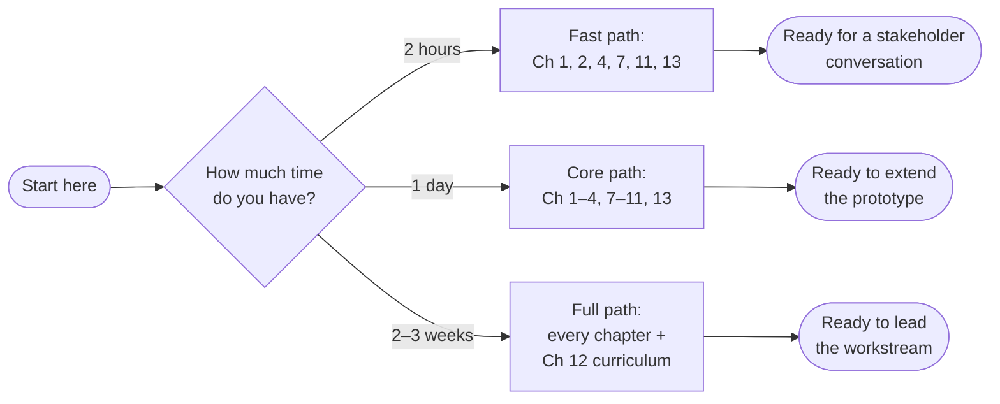

# Physical Agents & World Models — Zero to Hero

### An M-Files field guide to machines that see, remember, and help act in the physical world

*Volume 2 · 29 September 2026 · written for the VMAN Vision team · [volume history](VOLUMES.md)*

---

## Why this book exists

In 2026, "physical AI" stopped being a research topic and became a line item in factory budgets. Robots are being committed to production lines, and enterprise software vendors are racing to become the layer those robots trust before they act.

This book answers three questions, in plain language:

1. **What is all this?** Physical agents, world models, vision-language models, spatial grounding — what each one actually is, without the hype.
2. **Where does M-Files stand?** An honest map of our strengths and weaknesses, built from our own strategy pages, our own repositories, and dated external sources.
3. **What do we need to learn to close the gap?** A curriculum that covers exactly the tech areas the VMAN Vision goal needs — no more, no less.

It is written for an engineer who is smart, busy, and new to this area. Every chapter starts with an everyday scenario, builds the intuition, and only then gives the formal definition. Almost every section has a diagram.

> **The one sentence to remember:** M-Files will not win by building robots or out-modelling Google and Microsoft. It can win by being the **governed memory** a physical agent consults before it acts — and the book shows exactly which pieces of that memory exist today and which are still missing.

---

## How to use this book

The whole book takes about **6–8 hours** to read. You don't need to read it in order.

- **Fast path (2 hours)** — enough to hold a confident conversation with a product owner about what we're proposing and why.
- **Core path (1 day)** — enough to understand, run, and extend the prototype in this repository.
- **Full path (2–3 weeks)** — the complete zero-to-hero curriculum, including hands-on capstones.

Each chapter ends with a box called **"Where M-Files stands"** that connects the concept back to our actual situation. If you only read those boxes, you'll still learn the map.

---

## Table of contents

| # | Chapter | What you'll understand after reading it |
|---|---|---|
| 1 | [The map: where M-Files stands](01-the-map.md) | Our strengths, our gaps, and why this book is shaped the way it is |
| 2 | [What is a physical agent?](02-what-is-a-physical-agent.md) | The sense → think → act loop, and why a chatbot isn't one |
| 3 | [How machines see](03-how-machines-see.md) | Pixels → features → meaning; OCR vs. vision understanding |
| 4 | [Pointing, not describing](04-pointing-not-describing.md) | Spatial grounding — the capability our prototype demonstrates |
| 5 | [World models: imagining before acting](05-world-models.md) | Encoders, latent state, dynamics — and what a world model is *not* |
| 6 | [From seeing to doing: VLAs](06-from-seeing-to-doing.md) | How robots learn to act, and why M-Files doesn't need to train them |
| 7 | [Knowledge graphs: our secret weapon](07-knowledge-graphs.md) | Why a governed graph is the memory physical agents need |
| 8 | [Retrieval that can see](08-retrieval-that-can-see.md) | RAG → multimodal RAG → agentic RAG, and source attribution |
| 9 | [Agents, tools and MCP](09-agents-tools-mcp.md) | Giving the model hands: tool calling, agent loops, MCP |
| 10 | [Trust: evaluation, safety and governance](10-trust.md) | How to know it works, and how to keep it safe |
| 11 | [Putting it together: VMAN Vision](11-vman-vision.md) | The architecture, the competition, and "start small, land big" |
| 12 | [The hero's path: a curriculum](12-the-heros-path.md) | What to study, in what order, with hands-on capstones |
| 13 | [The handover: your first week](13-the-handover.md) | Repository tour, running the demo, open threads, next conversations |
| A | [Glossary](appendix-a-glossary.md) | Every term in one place |
| B | [Sources and verification status](appendix-b-sources.md) | Where every claim comes from, and how fresh it is |
| — | [Volume history](VOLUMES.md) | What changed in each volume, with a frozen PDF of every past volume |

A rendered PDF of the current volume lives next to these files: [`physical-agents-zero-to-hero.pdf`](physical-agents-zero-to-hero.pdf). Rebuild it with `python book/tools/build_pdf.py` after editing any chapter. Every published volume is also kept, unchanged, in [`volumes/`](volumes/). See [VOLUMES.md](VOLUMES.md) for how to cut a new one.

---

## A note on honesty

This book separates three kinds of statements, and so should you when you talk about this work:

| Label | Meaning | Example |
|---|---|---|
| **Demonstrated** | We ran it in this repository and kept the evidence | Gemini Robotics-ER 2 returned point-and-label output on engineering drawings |
| **Documented** | A vendor or an internal page says it, but we haven't tested it | Gemini ER 2 can track objects across video frames |
| **Hypothesis** | We think it's true and propose to test it | Visual evidence improves metadata extraction |

Mixing these up is the fastest way to lose a technical reviewer's trust. Keeping them apart is the fastest way to earn it.
