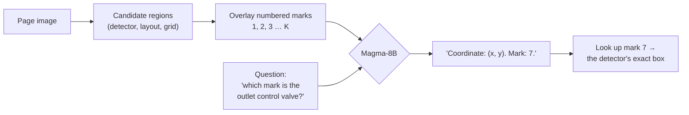

# Microsoft Magma: readiness guide

**Status (2026-09-29):** documentation only. Nothing in this file has been run in this repository. It collects what the Magma paper, model card, code repository and Azure documentation say, so that the first experiment can start as soon as compute is available.

Labels used below: **Documented** = stated by a primary source (cited); **Inferred** = our reading of those sources, to be confirmed; **Unknown** = not found in any source checked.

---

## 1. What changed since the last check

| Earlier belief (2026-08-22) | What the sources say now | Label |
|---|---|---|
| Magma has no hosted endpoint; the Foundry Labs page was a stub | Magma-8B is listed in the Microsoft Foundry model catalog (`microsoft-magma-8b`, version 9, lifecycle **Generally available**, published via the Hugging Face collection) [M5]; the Foundry Labs page now links to it [M6] | Documented |
| Using Magma means buying or borrowing GPUs | Hugging Face-collection models use **Foundry Managed Compute (preview)** when available: dedicated GPU instances in *our* Azure subscription, gated by a separate managed-compute GPU quota [M7] | Documented |
| Unknown hardware needs | Peak inference memory 17 GB in bfloat16, 7 GB in 4-bit, about 1.1 s per call (repo benchmark) [M3] | Documented |

So the blocker is no longer only "we have no GPUs." The likely Foundry path is to request managed-compute GPU quota in our Azure subscription, then verify that Magma is **Available in my Project** with a compatible accelerator and deployment template. Managed Compute is preview and availability remains project/region/quota dependent [M7].

---

## 2. What Magma is (from the paper)

*Magma: A Foundation Model for Multimodal AI Agents* — Yang et al., Microsoft Research and collaborators, arXiv 2502.13130, v1, 18 Feb 2025 [M1].

| Item | Value | Source |
|---|---|---|
| Model | Magma-8B, 8.6B parameters (model card lists ~9B, BF16) | [M1] Table 2; [M2] |
| Vision encoder | ConvNeXt-XXlarge; supports arbitrary resolutions; "global encoding" for high-resolution inputs up to ~2000 px | [M1] §4 |
| Language model | LLaMA-3-8B (decoder-only) | [M1] §4 |
| Training | Whole model tuned, vision encoder included; pretraining 3 epochs, constant LR 1e-5, batch 1024, base image size 512, up to 4 crops for UI/image data, 1 crop for video/robot | [M1] Appendix A, Table 9 |
| Training compute | "Maximally … either 32 Nvidia H100s or 64 AMD MI300 GPUs for all training jobs" | [M1] Table 9 caption |
| Pretraining data | ~39M samples: ~2.7M UI screenshots (SeeClick, Vision2UI), 970K robot trajectories (Open-X-Embodiment), ~25M samples from ~4M video clips (Epic-Kitchens, Ego4D, Something-Something v2), ~1.2M image-text pairs | [M1] §4.1 |
| License | MIT (code and weights) | [M2], [M3] |
| Languages | Primarily English | [M2] |

### The two ideas that matter for us

**Set-of-Mark (SoM) — action grounding.** Given an image, first extract *K* candidate regions or points (from a DOM tree, a detector, or a segmenter). Overlay them on the image as numbered marks. The model then answers by **choosing a mark** and giving its coordinates, rather than searching every pixel [M1] §3.2.

**Trace-of-Mark (ToM) — action planning.** In video, marks are tracked across frames (with CoTracker) and the model learns to predict each mark's future trajectory [M1] §3.2. Relevant only if we ever do video work — out of scope for static documents.



The ablation shows why this matters: removing SoM/ToM from pretraining drops ScreenSpot from 61.4 to 57.4 and SimplerEnv-Bridge from 35.4 to 17.7 [M1] Table 3.

---

## 3. Published results (zero-shot unless noted)

From [M1] Table 2. ScreenSpot cells are text/icon accuracy; for Magma and GPT-4V-OmniParser the candidate detections came from OmniParser ("detection results only, without local semantics").

| Model | SS-Mobile | SS-Desktop | SS-Web | SimplerEnv Google Robot | SimplerEnv Bridge |
|---|---|---|---|---|---|
| GPT-4V | 22.6 / 24.5 | 20.2 / 11.8 | 9.2 / 8.8 | – | – |
| GPT-4V-OmniParser | 92.7 / 49.4 | 64.9 / 26.3 | 77.3 / 39.7 | – | – |
| SeeClick | 78.0 / 52.0 | 72.2 / 30.0 | 55.7 / 32.5 | – | – |
| OpenVLA | – | – | – | 31.7 | 14.5 |
| **Magma-8B** | **60.4 / 58.5** | **75.3 / 52.9** | **69.1 / 52.0** | **52.3** | **35.4** |

Spatial reasoning, [M1] Table 6: VSR 65.1, BLINK-val 41.0, SpatialEval 64.5 (LLaVA-1.5-7B: 57.1 / 37.1 / 41.6; GPT-4o: 74.8 / 60.0 / –).

Reading for our use: on **text** elements Magma is beaten on mobile and web (GPT-4V-OmniParser 92.7 and 77.3 vs. Magma 60.4 and 69.1) and leads only on desktop. On **icon** elements it has the best score in all three splits (58.5 / 52.9 / 52.0 vs. at most 52.0 / 30.0 / 39.7). Engineering-drawing symbols look more like icons than like text — so symbol grounding on drawings is a reasonable hypothesis to test, not a result.

---

## 4. Three ways to run it

| Path | What you need | Where images go | Notes |
|---|---|---|---|
| **A. Foundry Managed Compute** (preferred if available) | Foundry project; **Cognitive Services Contributor** (or Foundry Owner) to deploy; **Foundry User** to call; managed-compute GPU quota for a compatible accelerator; model visible as **Available in my Project** [M7] | Stays in our Azure subscription; weights are stored on Azure [M7] | Managed Compute is preview. Confirm the deployment's endpoint/authentication details in the portal before coding against it. Billed per managed-compute GPU time, not per token [M7] |
| **B. Self-host with Hugging Face `transformers`** | One NVIDIA GPU with ≥ 24 GB for bf16 (17 GB peak [M3]); smaller with 4-bit | Our own machine | Needs a customised `transformers` build and `trust_remote_code=True` (§5) |
| **C. Self-host the repo's API server** | Same as B, plus the repo's FastAPI server or Docker | Our own machine | `cd server && ./magma-server.sh run` (port 8080; `/health`, `/predict`, `/predict_from_file`), or `./magma-server.sh docker up` [M3], [M4] |

### Path A — steps (from [M7])

1. In the Foundry portal: **Manage → Quota → Managed compute → Request quota** for a GPU family.
2. **Discover → Models**, collection **Hugging Face**, enable **Available in my Project**, find `microsoft-magma-8b`, then select **Deploy** if it is available.
3. Choose a deployment template and accelerator type (the portal pre-filters compatible ones), 1 instance for testing.
4. Wait for status **Succeeded**, run a test inference from the deployment page, then call it from code.

**Unknown until someone signs in:** whether the model is available in the intended project/region, which accelerator SKUs the deployment template offers, and the hourly price. The catalog page was read without signing in.

---

## 5. Path B — minimal working code

Verbatim pattern from the model card [M2], adapted to a local file:

```bash
conda create -n magma python=3.10 -y
conda activate magma
pip install torch torchvision pillow open_clip_torch
pip install git+https://github.com/jwyang/transformers.git@dev/jwyang-v4.48.2
```

```python
import torch
from PIL import Image
from transformers import AutoModelForCausalLM, AutoProcessor

dtype = torch.bfloat16
model = AutoModelForCausalLM.from_pretrained(
    "microsoft/Magma-8B", trust_remote_code=True, torch_dtype=dtype
).to("cuda")
processor = AutoProcessor.from_pretrained("microsoft/Magma-8B", trust_remote_code=True)

image = Image.open("OCR/public-pid-tank.png").convert("RGB")
convs = [
    {"role": "system", "content": "You are agent that can see, talk and act."},
    {"role": "user", "content": "<image_start><image><image_end>\nWhat is in this image?"},
]
prompt = processor.tokenizer.apply_chat_template(convs, tokenize=False, add_generation_prompt=True)
inputs = processor(images=[image], texts=prompt, return_tensors="pt")
inputs["pixel_values"] = inputs["pixel_values"].unsqueeze(0)
inputs["image_sizes"] = inputs["image_sizes"].unsqueeze(0)
inputs = inputs.to("cuda").to(dtype)

with torch.inference_mode():
    out = model.generate(**inputs, max_new_tokens=128, do_sample=False, use_cache=True, num_beams=1)
print(processor.decode(out[0, inputs["input_ids"].shape[-1]:], skip_special_tokens=True).strip())
```

Version pitfalls, all from primary sources:

- The model card says to install the custom fork above [M2]. The repo README says `transformers >= 4.49.0` *or* that fork [M3]. **Start with the fork** — it is what the model card was written against.
- The repo notes that its robot-planning demo may need `transformers` rolled back to 4.44.1 and `imageio[ffmpeg]` installed [M3]. Keep separate environments per demo.
- `flash-attn` must be installed after PyTorch if used [M4].
- `trust_remote_code=True` executes the model repository's own Python. Pin the model revision you tested.

---

## 6. Talking to it: input and output formats

**Input.** Chat template with a system message and an image placeholder: `<image_start><image><image_end>` followed by the question [M2].

**Output, as seen in the paper's training examples** [M1] Fig. 12:

```text
Coordinate: (0.17, 0.43). Mark: 3.
Coordinate: (0.07, 0.31, 0.66, 0.33). Mark: 0.
Text: News. Mark: 1.
```

Three things our parser must handle:

1. **Order and scale are different from Gemini.** Magma writes points as **`(x, y)` normalised to 0–1**. Gemini ER 2 writes **`[y, x]` on 0–1000**. The paper says coordinates are normalised by image size and quantised into 256 bins [M1] Fig. 3, so expect at most about two decimal places of real precision.
2. **The box format is ambiguous.** The paper's text describes UI boxes as `(x, y, w, h)` [M1] §3.2, but its examples read more naturally as `(x1, y1, x2, y2)` — for instance a one-line text box `(0.07, 0.31, 0.66, 0.33)`. **Confirm with one known box before writing the parser.** (Inferred.)
3. **Marks may come back without coordinates**, or coordinates without a mark ("… mark index if applicable").

Adapter to this repository's point contract (`{"point": [y, x], "label": ...}` on 0–1000):

```python
import re

POINT_RE = re.compile(r"Coordinate:\s*\(\s*([0-9.]+)\s*,\s*([0-9.]+)\s*\)(?:\.\s*Mark:\s*(\d+))?")


def magma_points_to_repo(text: str, label: str) -> list[dict]:
    points = []
    for x, y, mark in POINT_RE.findall(text):
        x, y = float(x), float(y)
        if not (0.0 <= x <= 1.0 and 0.0 <= y <= 1.0):
            continue  # reject rather than clamp; see book Chapter 4
        entry = {"point": [round(y * 1000), round(x * 1000)], "label": label}
        if mark:
            entry["mark"] = int(mark)
        points.append(entry)
    return points
```

This is a sketch for the first experiment. It was only checked against hand-written sample strings, not real Magma output. It keeps two-value points, drops out-of-range values, and deliberately skips four-value boxes until §6 point 2 is settled. When it lands in `prototype/providers/`, it needs the focused parsing tests `AGENTS.md` requires.

**Server path (C).** `/predict` takes `{"image": "<base64>", "prompt": "<text>"}` and returns `{"text_response": ..., "normalized_actions": [...], "delta_values": [...]}`; the two action arrays are for robot control and can be ignored for documents [M4]. The Foundry catalog page describes a separate action-token endpoint for robot actions [M5] — also out of scope.

---

## 7. Where the marks come from for engineering drawings

This is the biggest open design question. On UI screenshots the candidates come from the DOM tree or Android view hierarchy; in the paper's ScreenSpot run they came from OmniParser [M1]. Drawings have neither.

| Candidate source | How | Strength | Weakness |
|---|---|---|---|
| **Azure Document Intelligence layout** | Use its text lines, words and figure regions as marks | Deterministic boxes, already the citation layer in `complex-document-grounding-poc` | Misses unlabelled symbols |
| **OmniParser** (Microsoft) | The detector Magma was evaluated with | Proven pairing with Magma | Trained for UI screenshots, not drawings |
| **Uniform grid** | Overlay an N×N numbered grid | Needs nothing | Coarse; marks may cover several symbols |
| **A symbol detector** | Train or buy a P&ID symbol detector | Best fit | New work |

An attractive property, and a hypothesis to test: if Magma answers with a **mark ID**, the final coordinates come from the *detector's* box, not from the language model. That turns Magma into a chooser over deterministic regions — which lines up with the repository's position that Document Intelligence or Content Understanding should own citation geometry.

---

## 8. Fit and risk — read before promising anything

- **Domain gap.** Magma was pretrained on UI screenshots, robot frames and first-person video — no engineering drawings [M1] §4.1. Expect weaker results on P&IDs than on UI grounding until tested; the repo provides finetuning scripts (`scripts/finetune/finetune_magma_820k.sh`) if needed [M3].
- **Intended use.** The model card: "not intended to be deployed in production settings", and out-of-scope areas include "military and defense, financial services, and critical infrastructure systems" [M2]. The paper asks for "a human … in the loop and in control for every action" [M1]. Manufacturing plants can fall under critical infrastructure. **Treat Magma as a research and benchmark model; get a legal and responsible-AI review before any customer-facing use.**
- **Microsoft's own disclaimer on Hugging Face models in Foundry:** they are "Non-Microsoft Products that aren't tested or evaluated by Microsoft"; run your own risk and safety evaluation [M7].
- **Bias.** The authors note the video data is not representative of the global population [M1].

---

## 9. Blocker checklist

| # | Blocker | Status | Next action |
|---|---|---|---|
| 1 | Hosting / GPUs | **Path known** | Request Foundry managed-compute GPU quota; or one ≥ 24 GB NVIDIA GPU |
| 2 | Weights and license | **Resolved** — MIT, `microsoft/Magma-8B` | None |
| 3 | Deployment details (SKU, price, region) | **Unknown** | Sign in to Foundry, open the deploy wizard, record the template |
| 4 | Software environment | **Known** | Pin the fork, Python 3.10, model revision |
| 5 | Input format | **Known** | None |
| 6 | Output parsing | **Mostly known** | One calibration run to settle the box format |
| 7 | Mark source for drawings | **Open** | Try Document Intelligence regions and a grid on public fixtures |
| 8 | Accuracy on drawings | **Open** | Needs the labelled evaluation set (book Chapter 10) |
| 9 | Production use | **Open** | Legal / responsible-AI review; model card excludes production use |
| 10 | Name clash in this repo | **Open** | Rename the current `magma` provider (which calls Foundry `4Omni`) before adding real Magma, so results never get mixed up |

---

## 10. The first experiment, sized

1. Deploy (path A) or run locally (path B).
2. Run the §5 "what is in this image?" prompt on `OCR/public-pid-tank.png` to prove the environment works.
3. Build marks for the same fixture from a uniform grid, ask the Chapter 4 prompt ("point to the tank … the outlet control valve"), and record the raw text.
4. Settle the output format (§6 point 2) from that run.
5. Save the raw response, overlay and prompt under `demo-results/public-pid-tank/magma-8b/`, following the existing result conventions, and compare side by side with Gemini ER 2.

Everything after that — Document Intelligence marks, other fixtures, scoring — belongs with the labelled evaluation work.

---

## Sources

- [M1] Yang et al., *Magma: A Foundation Model for Multimodal AI Agents*, arXiv:2502.13130 v1 (18 Feb 2025) — https://arxiv.org/abs/2502.13130. Read in full 2026-09-29.
- [M2] Hugging Face model card, `microsoft/Magma-8B` — https://huggingface.co/microsoft/Magma-8B. Read 2026-09-29.
- [M3] Code repository README, `microsoft/Magma` — https://github.com/microsoft/Magma. Read 2026-09-29.
- [M4] Server README, `microsoft/Magma/server` — https://github.com/microsoft/Magma/tree/main/server. Read 2026-09-29.
- [M5] Microsoft Foundry model catalog, `microsoft-magma-8b` — https://ai.azure.com/catalog/models/microsoft-magma-8b. Read 2026-09-29, signed out.
- [M6] Microsoft Foundry Labs, Magma — https://labs.ai.azure.com/innovations/magma/. Read 2026-09-29.
- [M7] Microsoft Learn, *Hugging Face models in Microsoft Foundry* — https://learn.microsoft.com/azure/foundry/foundry-models/how-to/hugging-face-models. Read 2026-09-29.
- Project page: https://microsoft.github.io/Magma
