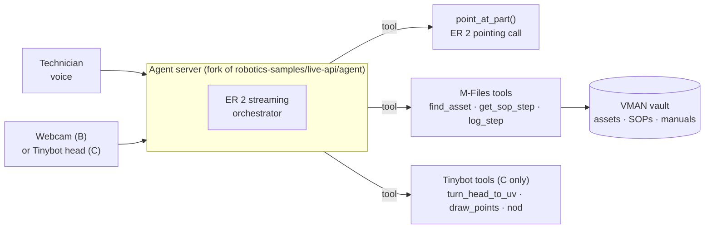

# VMAN Vision physical demo plan

**Drafted:** 2026-09-30
**Owners:** Viditya, Ankit
**Status:** Draft for discussion. Nothing here is built or purchased yet.
**Based on:** [spot-er2-demo-teardown.md](spot-er2-demo-teardown.md) and
[gemini-robotics-hardware-demo-survey.md](gemini-robotics-hardware-demo-survey.md).

## Goal

Show, live and in under three minutes, that an M-Files vault can become the
"memory" of a physical AI agent on a factory floor:

> A camera looks at a machine. A technician asks by voice, "What is this part
> and how do I replace it?" The agent points at the part on screen, finds that
> asset's manual and SOP in M-Files, reads out the right step, and watches
> the technician do it, confirming each step from the camera before moving on.

This is the Spot fetch loop from the teardown (detect → act → verify), with
the arm replaced by a person and the "item catalog" replaced by the VMAN asset
graph.

## Why this shape (and not a robot arm)

| Option | Wow factor | Cost / risk | Tells the M-Files story? |
|---|---|---|---|
| A. Simulation only (browser/MuJoCo) | Low | Lowest | Weakly |
| **B. Camera + agent guides a human** (`human` embodiment) | Medium | Very low (laptop webcam) | **Yes, strongly:** documents drive the work |
| **C. Pan-tilt "Tinybot" head** looks, points, talks | High | ≈ USD 627 BOM (Google estimate) + build time | **Yes:** plus a visible physical agent |
| D. Low-cost arm that picks parts | Highest | High: no grasp planner, we own calibration and IK | Adds robotics, not document value |
| E. Spot or industrial robot | Highest | Not realistic to buy; partner/loan only | Yes, but the story would belong to the robot vendor |

**Recommendation:** build **B first**, then upgrade to **C** if B lands well.
Keep D and E out of scope unless a partner lends hardware. The teardown shows
Spot's demo works because Boston Dynamics already solved grasping; we should
not try to re-solve that for a hackathon.

## Architecture (reusing Google's agent server)

New code we would write is small and isolated:

- **An `mfiles` tool group**: `find_asset(description)`,
  `get_sop_step(asset_id, step)`, `log_maintenance_step(asset_id, step,
  evidence_frame)`. Start against a **mock vault using public fixtures**
  (no customer data), then point at a test VMAN vault.
- **A `point_at_part(instruction)` tool** reusing the detector pattern from
  `spot/apps/manipulation/gemini_detector.py` and this repo's existing
  `prototype/providers/gemini_robotics.py` point parsing.
- **A maintenance developer instruction** (`maintenance_di.md`) modelled on
  `spot_di.md` and `human_di.md`.

Guardrails to copy from the Spot code: one-time targets, the stable-camera
gate before pointing, "unverified until seen in a fresh frame", and speaking
only through `send_message` after the action.

## Phases

| Phase | Scope | Exit criteria | Hardware |
|---|---|---|---|
| **0. Access check** | Confirm our Gemini key can open a Live API session on `gemini-robotics-er-2-streaming-preview` and call `gemini-robotics-er-2-preview`. Run Google's agent server unmodified with the `human` embodiment on a laptop. | A logged session where the model sees the webcam, calls a tool, and speaks. | Laptop only |
| **1. Mock-vault loop (option B)** | Add `mfiles` tools against a JSON mock of 2–3 public assets and one SOP; add `point_at_part`; write `maintenance_di.md`. | 3-minute recorded run: identify part → fetch SOP step → guide one step → confirm from camera. Failure modes logged. | Laptop + a physical prop (a real pump, valve, or printed P&ID/assembly) |
| **2. Real vault** | Swap the mock for a test VMAN vault through the M-Files API / MCP Server; log the step back as vault metadata. | Same run, data read from and written to a vault. | Same |
| **3. Physical agent (option C)** | Build or buy the Tinybot-class head; enable its embodiment; the head turns to the part and draws the point overlay. | Same run with the head tracking the part on screen. | Tinybot BOM |
| 4. Stretch | Video progress classification ("is the step done?"), multi-view check, gauge reading. | Each claim shown on rendered evidence. | Same |

Phases 0–2 need no purchase approval.

## Suggested split

| Area | Viditya | Ankit |
|---|---|---|
| Phase 0 access check and running Google's server | | ✅ (can start 1–6 Oct) |
| `point_at_part` tool (reuses our prototype provider) | ✅ | |
| Mock vault + `mfiles` tools | | ✅ |
| `maintenance_di.md` prompt and guardrails | ✅ | review |
| Real VMAN vault wiring (Phase 2) | ✅ with VMAN team | |
| Hardware sourcing (Phase 3) | decide | quote |

Adjust freely; this is a starting point for your discussion.

## Decisions needed (candidate agenda for the 7 Oct VMAN meeting)

1. Is the "agent guides a technician using vault documents" story the right
   one for VMAN, or should the demo lead with inspection (the Boston Dynamics
   angle)?
2. Is there a test VMAN vault with asset + SOP objects we may use, and through
   which API (REST, MCP Server)?
3. Target event and date (internal hackathon, customer event, leadership
   review)? This decides whether Phase 3 hardware is worth buying.
4. Budget owner for Phase 3 hardware (≈ USD 627 per Google's Tinybot estimate,
   before shipping or local sourcing).

## Risks

| Risk | Mitigation |
|---|---|
| Streaming ER 2 is a preview endpoint; access, behaviour, or quotas may change. | Phase 0 exists to confirm access first. Keep a fallback to `gemini-3.1-flash-live-preview` as orchestrator plus ER 2 for pointing only. |
| Pointing is wrong on shiny/cluttered parts. | Stable-camera gate, re-detect loop, visible overlay; choose a prop with distinct parts. |
| Live API sessions store data server-side by default. | Use only public fixtures and props until data-handling terms are checked (see [gemini-robotics-model-guide.md](gemini-robotics-model-guide.md)). |
| People in the webcam frame (privacy/consent). | Record only consenting team members; follow the consent notes in the model guide. |
| Tinybot needs Dynamixel servos and a RealSense camera, which may have long lead times locally. | Only order after Phase 2 succeeds; a USB webcam on a hobby pan-tilt kit is a cheaper stand-in (unquoted). |
| Scope creep into robotics. | This plan stops at a camera head. Arm work needs its own decision. |

## Out of scope

- Buying Spot or any industrial robot.
- Building a grasping arm.
- Using customer documents in the demo repository.

## Sources

- [spot-er2-demo-teardown.md](spot-er2-demo-teardown.md) (how the Spot demo works, with file-level citations)
- [google-gemini/robotics-samples — live-api](https://github.com/google-gemini/robotics-samples/tree/main/live-api)
- Tinybot BOM: `live-api/tinybot/deps/pt_head/bom.csv` in the same repository (estimated total USD 626.87)
- [Google blog: Introducing Gemini Robotics ER 2](https://blog.google/innovation-and-ai/models-and-research/google-deepmind/gemini-robotics-er-2/)
