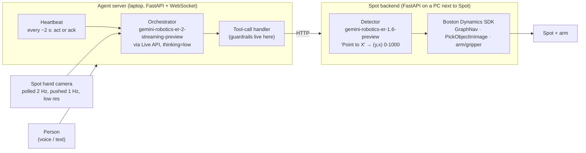

# How the Spot + Gemini Robotics-ER 2 fetch demo works

**Researched:** 2026-09-30
**Question:** Google's ER 2 launch showed a Boston Dynamics Spot fetching a
popcorn snack from a spoken command. How was that made to work, and what can
we reuse for a VMAN Vision demo?

## What is public and what is not

| Evidence | Source | Status |
|---|---|---|
| The claim: ER 2 "controls Spot APIs, including navigation and manipulator movement, to fetch objects using natural language commands"; the popcorn clip is one example. | [Google blog: Introducing Gemini Robotics ER 2](https://blog.google/innovation-and-ai/models-and-research/google-deepmind/gemini-robotics-er-2/) | Public marketing. |
| Working code for a Spot agent with the same fetch pattern: voice command → navigate → detect → pick → carry → place/hand off. | [`google-gemini/robotics-samples/live-api`](https://github.com/google-gemini/robotics-samples/tree/main/live-api) (`agent/`, `spot/`), commits of 2026-07-29/30 | Public, Apache-2.0. Read line by line for this doc. |
| The exact popcorn script, map, and scene. | — | **Not published.** The public app delivers drink cans from a `snack1` station instead. The architecture below is the published one; we infer the popcorn clip used it. |
| Internal model variants listed in the code (e.g. `robotics_er_live_text_only_2p0_no_safety_classifiers`) and a gRPC "Robotics Developer API" client. | `agent/session_config.py`, `agent/model/robotics_developer_client.py` | Present in code, **not public endpoints**. Do not plan on them. |

We have **not** run this code or watched the popcorn clip frame by frame.
Everything below describes the published source.

## The one-sentence answer

ER 2 does **not** move Spot's motors. It is a live "brain" that listens,
watches one camera, and calls about a dozen high-level tools. A second Gemini
Robotics model picks the pixel to grab. Boston Dynamics' own mature SDK does
the walking, route-following and grasp planning.

## Architecture

### Three layers, three different owners

| Layer | Who does it | What it decides |
|---|---|---|
| **Orchestrator** | `gemini-robotics-er-2-streaming-preview` over the Gemini Live API (bidirectional audio + video + function calling). Default `thinking_level` is `low`. | Which tool to call next, in what order; when a step is done; what to say to the person. |
| **Perception (pointing)** | `gemini-robotics-er-1.6-preview`, called by the Spot backend with `temperature=0`, JSON output. Prompt: *"Point to {instruction}. Output JSON only… normalized 0 to 1000, y first, then x."* | The single pixel to grasp or place at. The orchestrator never sees or passes coordinates. |
| **Motion** | Boston Dynamics SDK (`bosdyn-client`): GraphNav navigation on a pre-recorded map; `PickObjectInImage` grasp planner (pixel + camera model + depth → grasp, constrained top-down); arm stow/carry/open. | How to actually walk there and close the gripper safely. |

This split is the most important learning. The model is strong at "what" and
"which one"; the robot vendor's stack handles "how".

## The fetch sequence (from `prompt/data/spot_di.md`)

1. `navigate(waypoint="<station>")`, only after `get_waypoints()` confirms
   `navigation_ready`, and only after `stow()` (arm tucked before walking).
2. `detect(instruction="<item>")`: the backend grabs a colour + depth frame,
   the ER 1.6 detector returns one point, and the backend stores it as a
   **one-time target** and draws it on the UI.
3. The orchestrator inspects the overlay. If the point is on the wrong object,
   it re-detects with a better instruction instead of picking.
4. `pick()` takes **no arguments** and consumes the stored target.
5. `stow()` moves the arm to a carry pose when an item is held.
6. `navigate(waypoint="<destination>")`.
7. Either `detect("<placement surface>")` then `place()`, or
   `wait_for_pick_up()`: the arm watches for an external force change as the
   person lifts the item (the manipulation client's default threshold is
   5 N), then opens the gripper.
8. `stow()`.

Other tools: `look` (aim the hand camera ±~0.15 rad steps), `drive` (short
0.1–2 s velocity moves), `stop`, `stand`, `sit`, `health_check`, `ack`,
`send_message`.

## The engineering tricks that make it reliable

These are enforced **in code**, not only in the prompt.

| Trick | Where | Why it matters |
|---|---|---|
| **Model never handles coordinates for motion.** `detect` stores a one-time target; `pick`/`place` take no pixel args. | `spot_di.md`, `tool_call_handler.py` | Removes a whole class of hallucinated-coordinate failures. |
| **Any motion invalidates the target.** Every non-detect/pick/place action calls `clear_detected_target()`. | `spot_embodiment.py` | Prevents grabbing where the object *used to be* in the image. |
| **Camera must be stable ~3 s before detect/pick/place**, else the call returns `blocked_camera_unstable` and the target is cleared. | `tool_call_handler.py` | Blurry or moving frames give bad points. |
| **"Success" is never trusted from the robot alone.** The pick result is rewritten to `unverified` or `failed`; the model must confirm from a **fresh post-action camera frame** that the item is in the gripper. | `pick_response_for_model()` | Stops the classic "robot says done, nothing happened" demo failure. |
| **Blocking vs non-blocking tools.** While a blocking tool runs, the heartbeat pauses so the model is not re-prompted mid-action; the latest frame is sent before the tool result. | `tool_call_handler.py`, `tools.py` | Keeps the model's view in sync with reality. |
| **Heartbeat loop.** Roughly every 2 s (event-driven) the model is prompted and must either act or call `ack`. | `server.py`, `spot_di.md` | Turns a chat model into a closed-loop controller that notices progress and failures. |
| **Hard guardrail on risky verbs.** `sit` is only allowed if the user's own transcript matches a "sit" regex (not negated). | `tool_call_handler.py` | Some safety cannot be left to the prompt. |
| **Speak only through a tool.** The model must use `send_message` and must call the action first, then speak. | `spot_di.md` | Narration always matches what the robot actually did. |
| **Navigation is pre-mapped.** GraphNav map recorded beforehand with printed AprilTag (`tag36h11`) fiducials; named waypoints like `snack1`, `home`; the model may not invent names. | `spot/apps/navigation/` | The model chooses destinations; it never plans paths. |

## What it needed physically

- Spot **with the arm and gripper** (hand colour + depth camera used for both
  the model's view and grasping).
- A PC on Spot's network running the Spot FastAPI backend (holds the lease).
- A laptop running the agent server + browser UI (mic/speaker).
- A pre-recorded GraphNav map, printed AprilTags on walls, named waypoints.
- Gemini API key with access to both ER endpoints.

## Cheaper embodiments in the same repo

The same agent server supports two other bodies, which matters for our scope:

| Embodiment | Hardware | What the model can do |
|---|---|---|
| `human` | Just a laptop webcam and speaker. | Watches through the webcam and tells a **person** what to do next (`run_instruction`), step by step, re-checking via heartbeat. |
| `tinybot` | Tabletop pan-tilt head: 2 Dynamixel servos, Intel RealSense D415 depth camera, mic array, speaker. Google's own BOM estimate: **≈ USD 627** (`tinybot/deps/pt_head/bom.csv`). | Looks around, turns to a pixel (`turn_head_to_uv`), nods/shakes, draws labelled point overlays on the camera feed, talks. No arm. |

## What this means for VMAN Vision

1. **Copy the three-layer split.** ER 2 orchestrates; an ER pointing call finds
   the thing; deterministic code (our VMAN/M-Files lookups, or a vendor robot
   SDK) does the rest.
2. **Grasping is the expensive part, not the AI.** Spot works because
   `PickObjectInImage` already exists. A low-cost arm has no such planner; we
   would own depth calibration, inverse kinematics and grasp logic. That is the
   biggest schedule risk of any "robot picks something up" demo.
3. **The `human` + `tinybot` embodiments map directly onto maintenance.** "Look
   at the machine → point at the part → pull its manual/SOP from M-Files → tell
   the technician the next step → verify from the camera" is the Spot loop with
   the arm replaced by a person.
4. **Reuse the guardrails verbatim:** one-time targets, stable-camera gate,
   visually verified success, speak-after-act.

The plan built on this is in [physical-demo-plan.md](physical-demo-plan.md).

## Sources

- Google: [Introducing Gemini Robotics ER 2](https://blog.google/innovation-and-ai/models-and-research/google-deepmind/gemini-robotics-er-2/)
- Code: [google-gemini/robotics-samples — live-api](https://github.com/google-gemini/robotics-samples/tree/main/live-api) (files cited above: `agent/prompt/data/spot_di.md`, `agent/core/tool_call_handler.py`, `agent/embodiment/spot/spot_embodiment.py`, `agent/session_config.py`, `agent/server.py`, `spot/apps/manipulation/gemini_detector.py`, `spot/apps/manipulation/spot_client.py`, `spot/apps/navigation/tags/README.md`, `tinybot/deps/pt_head/bom.csv`)
- Google Gemini API: [Gemini Robotics overview](https://ai.google.dev/gemini-api/docs/robotics-overview)
- Boston Dynamics: [AIVI-Learning now powered by Google Gemini Robotics](https://bostondynamics.com/blog/aivi-learning-now-powered-google-gemini-robotics/)
- Related in this repo: [gemini-robotics-model-guide.md](gemini-robotics-model-guide.md), [gemini-robotics-hardware-demo-survey.md](gemini-robotics-hardware-demo-survey.md)
